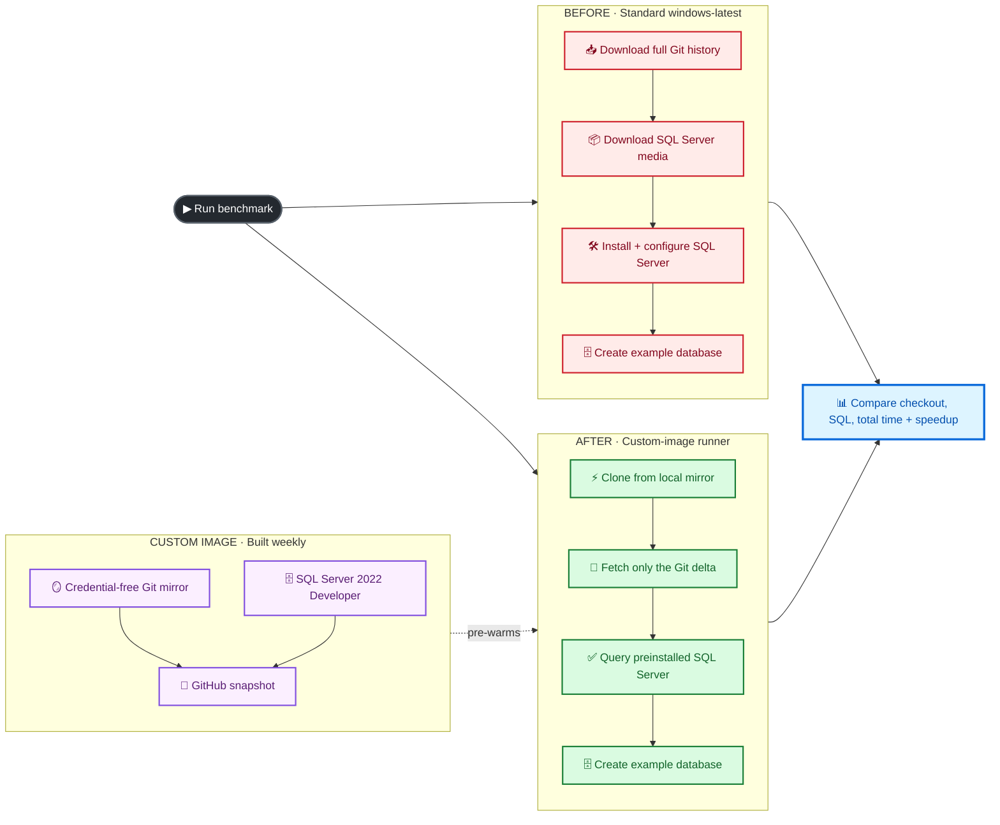
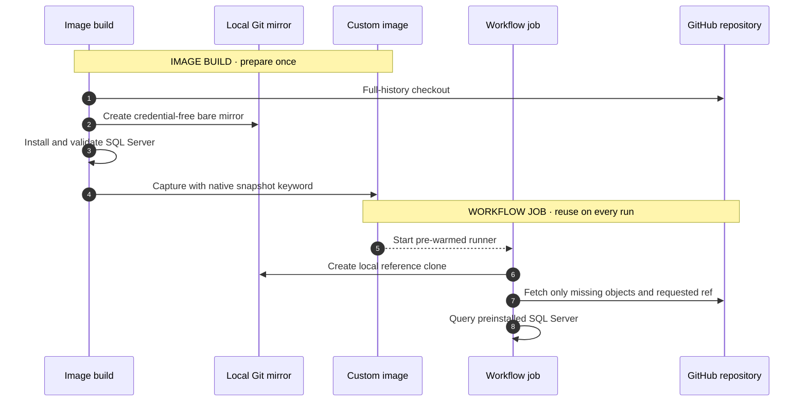

<div align="center">

# 🚀 GitHub Actions Custom Images

### Turn slow, repetitive runner setup into a fast, ready-to-work environment

[](https://github.com/actions/runner-images)
[](https://docs.github.com/en/enterprise-cloud@latest/actions/how-tos/manage-runners/larger-runners/use-custom-images)
[](https://learn.microsoft.com/sql/database-engine/install-windows/install-sql-server)
[](https://docs.github.com/en/enterprise-cloud@latest/actions/how-tos/manage-runners/larger-runners/use-custom-images)

**Example 01 · Large monorepo checkout + preinstalled SQL Server**

[See the architecture](#-the-big-idea) ·
[Run the demo](#-run-the-demo) ·
[Understand the results](#-what-the-benchmark-measures)

</div>

---

## ✨ Why custom images?

Every minute spent rebuilding the same environment is a minute that every
workflow run—and every developer waiting on it—pays again.

| Without a custom image | With a custom image |
|---|---|
| 📥 Download the complete Git history | ⚡ Reuse Git objects already on disk |
| 📦 Download SQL Server installation media | ✅ SQL Server is already installed |
| 🛠️ Run unattended installation and configuration | 🟢 Start the service and query it |
| ⏳ Repeat the work in every job | 🎯 Fetch only changes since the image build |
| 🌐 Depend heavily on network throughput | 💾 Shift stable dependencies to the image |

> [!TIP]
> The value is not merely “a faster VM.” A custom image removes deterministic,
> repeated setup work from the critical path of every job.

## 🎯 The centerpiece: before vs. after

This example compares two jobs that produce the **same outcome**:

- a complete Git checkout with full history; and
- a running SQL Server instance containing an empty `CustomImageExample`
  database.



### The expected shape of the result

The workflow writes the real values from each run to the GitHub Actions job
summary:

| Measurement | 🔴 Before: `windows-latest` | 🟢 After: custom image |
|---|---:|---:|
| Full-history checkout | Complete network clone | Local objects + small delta |
| SQL Server setup | Download + install + readiness | Readiness check only |
| **Total measured setup** | **Cold path** | **Pre-warmed path** |
| Result | Baseline | Seconds saved, percentage reduction, and speedup |

Actual numbers depend on repository size, repository growth, image freshness,
runner size, and network conditions. This starter repository is intentionally
small; the checkout benefit becomes visible as it grows into a large monorepo.
The workflow reports measurements instead of promising a synthetic “5-minute
to 5-second” result.

## 🧠 The big idea

The image-generation workflow checks out the complete repository once and
creates a sanitized bare mirror:

```text
C:\ProgramData\GitHubCustomImage\repository.git
```

The consumer job creates a no-checkout clone backed by that local object store.
It then hands control to `actions/checkout`, which authenticates normally and
fetches the exact branch, tag, or pull-request SHA requested by the event.



### Why this strategy?

| Benefit | How this example delivers it |
|---|---|
| ⚡ **Fast checkout** | Existing Git objects are read from the image; only the delta crosses the network |
| 🔐 **No baked credentials** | The build uses `persist-credentials: false` and rejects auth headers or token markers |
| 🎯 **Correct revision** | `actions/checkout` still resolves and checks out the event’s requested SHA |
| 🍴 **Fork-friendly** | Runtime authentication remains read-only and scoped to the workflow job |
| 🔁 **Repeatable** | A weekly image build refreshes Git history, Windows patches, and SQL media |
| 📏 **Measurable** | Equivalent before/after jobs publish an automated comparison table |

## 🏃 Run the demo

### 1 · Create the image-generation runner

Custom images are available for **GitHub-hosted larger runners**. The custom
image can start from GitHub’s `windows-latest` image, but it is consumed through
a named larger runner—not through the standard `windows-latest` label.

1. Enable custom images in the organization or enterprise Actions policy.
2. Create a GitHub-hosted larger runner with:
   - **Platform:** Windows x64
   - **Base image:** GitHub-owned `windows-latest`
   - **Generate custom images:** enabled
   - **Runner group:** one that can access this repository
3. Name it `windows-image-generation`, or set the organization variable
   `IMAGE_GENERATION_RUNNER` to the actual runner name.
4. Run **Build Windows monorepo image** from the Actions tab.

The [image workflow](.github/workflows/build-custom-image.yml) installs and
validates SQL Server, creates and verifies the Git mirror, checks for captured
credentials, and publishes `windows-monorepo-sqlserver` only after every step
succeeds.

> [!NOTE]
> GitHub may continue provisioning the image after the workflow completes.
> Each successful run creates a new image version and consumes Actions storage.

### 2 · Create the custom-image runner

1. Create another GitHub-hosted larger runner.
2. Choose **Windows x64**.
3. On the **Custom** image tab, select `windows-monorepo-sqlserver`.
4. Use the same runner group as the image-generation runner.
5. Name it `windows-monorepo-sqlserver-runner`, or set
   `CUSTOM_IMAGE_RUNNER` to the actual runner name.

### 3 · Run the comparison

Open **Actions → Compare before and after custom image → Run workflow**.

The [comparison workflow](.github/workflows/compare-before-after.yml) starts the
cold and pre-warmed jobs in parallel, then publishes:

```text
checkout duration
SQL Server installation/readiness duration
total measured setup duration
seconds saved
percentage reduction
overall speedup
```

Both timers begin in the first measured step. Runner queue and provisioning
time are excluded because those values reflect runner capacity and service
conditions—not setup work removed by the image.

## 📊 Optional: see what the runners are doing

Enable the **Collect CPU, memory, disk, network, and process telemetry** option
when dispatching the comparison workflow to add
[Runner Telemetry Action](https://github.com/marketplace/actions/runner-telemetry-action)
reports to both jobs.

Telemetry complements the timing table:

- **network and disk I/O** make the cold clone versus local mirror visible;
- **top processes** show SQL Server setup activity on the baseline;
- **CPU and memory** help distinguish image benefits from runner-sizing issues;
- **per-job reports** provide evidence for both the before and after paths.

It is disabled by default so the core benchmark stays minimal. When enabled,
the action starts **before** the measured region and stops **after** it, so its
setup and report-generation overhead are excluded from the comparison. The
workflow pins the action to the commit currently referenced by the `v1` tag rather than
executing a mutable tag directly.

## 📁 Explore the implementation

| File | Role |
|---|---|
| [`.github/workflows/build-custom-image.yml`](.github/workflows/build-custom-image.yml) | Builds, validates, versions, and snapshots the Windows image |
| [`.github/workflows/compare-before-after.yml`](.github/workflows/compare-before-after.yml) | Runs the fair before/after benchmark and publishes results |
| [`scripts/Install-SqlServer.ps1`](scripts/Install-SqlServer.ps1) | Downloads official media and installs SQL Server 2022 Developer silently |
| [`scripts/Seed-GitRepository.ps1`](scripts/Seed-GitRepository.ps1) | Builds and sanitizes the bare repository mirror |
| [`scripts/Initialize-WarmCheckout.ps1`](scripts/Initialize-WarmCheckout.ps1) | Creates the local reference clone before `actions/checkout` |
| [`scripts/Test-SqlServer.ps1`](scripts/Test-SqlServer.ps1) | Waits for SQL Server, runs a query, and optionally creates the demo database |

## 🛡️ Security and operational guardrails

> [!CAUTION]
> Never bake secrets, access tokens, production data, or long-lived
> credentials into a custom image.

- **No credentials are captured.** The mirror uses a plain HTTPS origin, and
  the build fails if it detects an authentication header or token marker.
- **Secrets arrive at runtime.** `actions/checkout` uses the job’s short-lived
  `GITHUB_TOKEN`.
- **Image freshness matters.** The build runs weekly, following GitHub’s
  recommendation; increase the cadence for high-churn monorepos.
- **Storage is not free.** Every successful snapshot creates an image version.
  Configure an appropriate custom-image retention policy.
- **SQL Server Developer is for development and CI.** Review Microsoft’s terms
  and choose a properly licensed edition for other uses.
- **Test data stays disposable.** The benchmark creates its database at job
  runtime rather than capturing mutable data in the image.

## 🗺️ More examples are coming

This repository is designed as a growing gallery. Each future example will
answer the same three questions:

1. **What repeated work is slowing jobs down?**
2. **What belongs safely in a reusable image?**
3. **How much faster is the measured before/after result?**

| Example | Use case | Status |
|---:|---|:---:|
| **01** | Windows monorepo checkout + SQL Server | 🟢 Available |
| **02** | Coming next | ⚪ Planned |
| **03** | Coming next | ⚪ Planned |

---

## 📚 References

- [Using custom images for GitHub-hosted larger runners](https://docs.github.com/en/enterprise-cloud@latest/actions/how-tos/manage-runners/larger-runners/use-custom-images)
- [Runner Telemetry Action](https://github.com/marketplace/actions/runner-telemetry-action)
- [SQL Server unattended installation](https://learn.microsoft.com/sql/database-engine/install-windows/install-sql-server-from-the-command-prompt)
- [Community custom-image examples](https://github.com/km-allthethings/build-custom-images)

<div align="center">

### Build once · Validate once · Start every job ready

</div>
