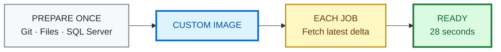
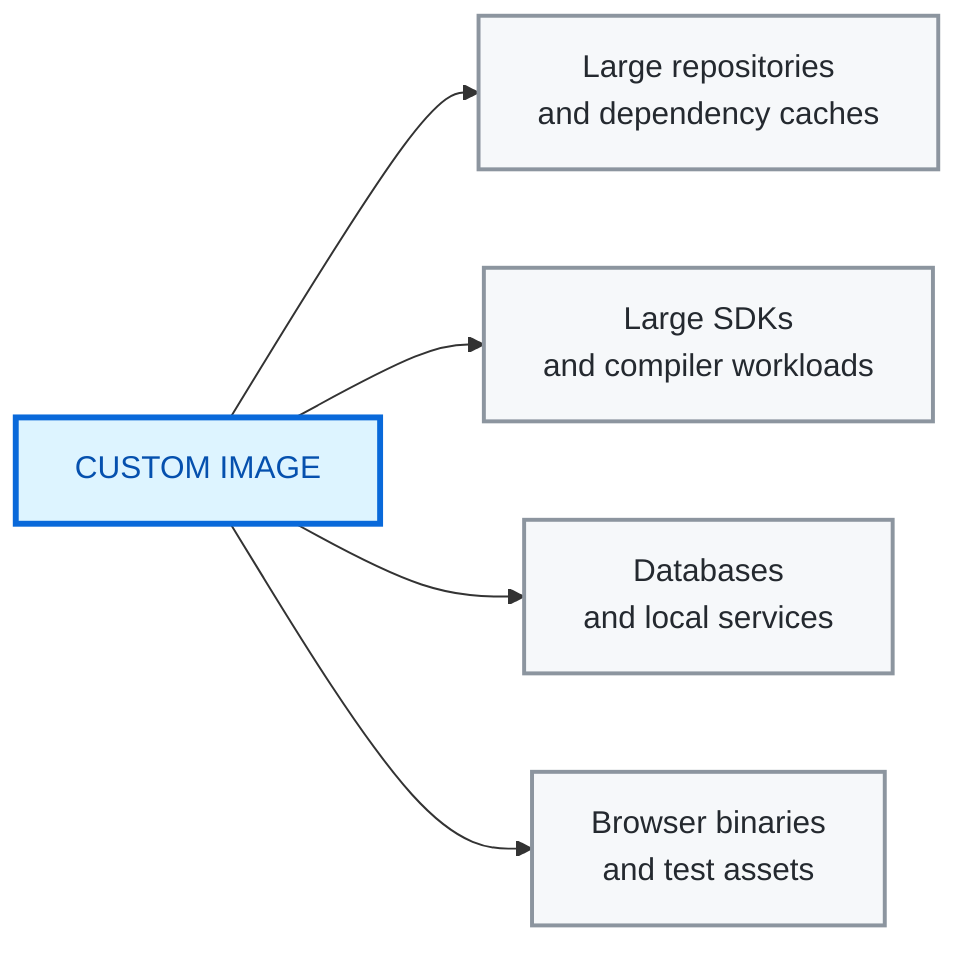

<div align="center">

# GitHub Actions · Custom Images

### A Windows runner, already prepared.

[](https://github.com/actions/runner-images)
[](https://docs.github.com/en/enterprise-cloud@latest/actions/how-tos/manage-runners/larger-runners/use-custom-images)
[](https://learn.microsoft.com/sql/database-engine/install-windows/install-sql-server)

**01 / Large monorepo checkout + SQL Server**

</div>

---

## ◈ Proven outcome

<table>
<tr>
<td align="center" width="33%">
<sub>TIME TO READY</sub>
<h2>12:06 → 0:28</h2>
</td>
<td align="center" width="33%">
<sub>SETUP REMOVED</sub>
<h2>96.2%</h2>
</td>
<td align="center" width="33%">
<sub>FASTER FEEDBACK</sub>
<h2>26.1×</h2>
</td>
</tr>
</table>

| | Standard runner | Custom image |
|---|---:|---:|
| Git checkout | 8 min 42 sec | **27 sec** |
| SQL Server ready | 3 min 24 sec | **0.27 sec** |
| **Ready for work** | **12 min 06 sec** | **28 sec** |

<div align="center">

[](https://github.com/tsvi-solutions/custom_images_examples/actions/runs/38083459558)

</div>

<p align="center">
<sub>LLVM · 186,978 files · full history · image 1.1.0</sub>
</p>

## ↯ Build once. Reuse everywhere.



The image carries the stable setup. The job still authenticates normally and
uses `actions/checkout`; it simply downloads the changes made since the image
was built.

<details>
<summary><strong>Why the warm checkout is safe and fast</strong></summary>

The image contains:

```text
C:\ProgramData\GitHubCustomImage\repository.git
C:\ProgramData\GitHubCustomImage\worktree
```

At runtime, `Initialize-WarmCheckout.ps1` moves the prepared worktree into
`GITHUB_WORKSPACE` on the same disk. It normalizes the remote URL and detaches
`HEAD` with a metadata-only ref update so `actions/checkout` does not rescan
every file before fetching.

The custom path uses `clean: false` because:

1. the image build already proves the worktree is clean;
2. every GitHub-hosted runner starts on a fresh ephemeral VM; and
3. `actions/checkout` still force-checks the pinned target SHA.

The build uses `persist-credentials: false` and scans both cached Git
repositories for authentication headers or token markers before snapshotting.

</details>

## ▶ Run the demo

| `01` GENERATE | `02` BUILD | `03` ATTACH | `04` COMPARE |
|---|---|---|---|
| Create `windows-image-generation` | Run **Build Windows monorepo image** | Create consumer runner using **Latest** | Run **Compare before and after** |

> [!IMPORTANT]
> Create both runners from **organization settings**. Custom images require
> GitHub-hosted larger runners and cannot run on the standard
> `windows-latest` label.

<details>
<summary><strong>Exact runner and repository setup</strong></summary>

### 1. Image-generation runner

Open:

```text
https://github.com/organizations/YOUR-ORGANIZATION/settings/actions/runners
```

Choose **New runner → New GitHub-hosted runner**:

| Setting | Value |
|---|---|
| Platform | Windows x64 |
| Base image | GitHub-owned `windows-latest` |
| Generate custom images | Enabled |
| Name | `windows-image-generation` |

If you use another name, set the `IMAGE_GENERATION_RUNNER` Actions variable.
Enable custom images in the
[organization or enterprise Actions policy](https://docs.github.com/en/enterprise-cloud@latest/admin/enforcing-policies/enforcing-policies-for-your-enterprise/enforcing-policies-for-github-actions-in-your-enterprise#custom-images).

Run **Build Windows monorepo image**. The workflow publishes:

```text
windows-monorepo-sqlserver
```

GitHub may continue provisioning the image after the workflow finishes. See
[Generating a custom image](https://docs.github.com/en/enterprise-cloud@latest/actions/how-tos/manage-runners/larger-runners/use-custom-images#generating-a-custom-image).

### 2. Consumer runner

Create a second GitHub-hosted larger runner:

| Setting | Value |
|---|---|
| Platform | Windows x64 |
| Image | Custom → `windows-monorepo-sqlserver` |
| Version | **Latest** |
| Size | 4 cores, 16 GB RAM, 150 GB SSD |
| Maximum concurrency | 1 |
| Name | `windows-monorepo-sqlserver-runner` |

If you use another name, set the `CUSTOM_IMAGE_RUNNER` Actions variable.
Selecting
[**Latest**](https://docs.github.com/en/enterprise-cloud@latest/actions/how-tos/manage-runners/larger-runners/use-custom-images#installing-custom-images)
lets the runner adopt newly published versions. Pin a version only for a
deliberate rollback.

### 3. Optional benchmark settings

| Setting | Required | Purpose |
|---|:---:|---|
| `BENCHMARK_REPOSITORY` variable | No | Defaults to `llvm/llvm-project` |
| `BENCHMARK_TOKEN` secret | Private repositories only | Read-only Contents token |
| `CUSTOM_IMAGE_MAX_AGE_DAYS` variable | No | Defaults to 10 days |

Changing `BENCHMARK_REPOSITORY` requires rebuilding the image.

</details>

## ◇ Economics

### Scale across a month · private repository example

| Runs / month | Without custom image | With custom image* |
|---:|---:|---:|
| 1,000 | **$130.00** | **$26.67** |
| 10,000 | **$1,300.00** | **$224.67** |
| 50,000 | **$6,500.00** | **$1,104.67** |

> At **50,000 runs per month**: **$6,500 without** the custom image versus
> **$1,104.67 with** it, before storage.

<sub>
* Includes $4.67/month for image-build and canary compute. Assumes private
standard Windows minutes are billable after plan allowances. Storage excluded.
</sub>

<details>
<summary><strong>Cost assumptions and break-even calculation</strong></summary>

As of October 10, 2026, a Windows 4-core larger runner costs
[$0.022/minute](https://docs.github.com/en/enterprise-cloud@latest/billing/reference/actions-runner-pricing),
and each job rounds up to a whole minute.

| Scenario | Without custom image | With custom image |
|---|---:|---:|
| Private standard Windows after included minutes | **$0.130** | **$0.022** |
| Same 4-core larger runner | **$0.286** | **$0.022** |
| Public repository used by this demo | **$0.000** | **$0.022** |

The observed weekly image build costs about **$4.00/month** and the daily
canary about **$0.67/month**. Before storage, maintenance compute breaks even
at approximately **44 private standard-Windows jobs/month**, or **18 jobs**
when both paths already require the same 4-core larger runner.

This README does not convert elapsed CI time directly into developer dollars.
The
[SPACE framework](https://www.microsoft.com/en-us/research/publication/the-space-of-developer-productivity-theres-more-to-it-than-you-think/)
from Microsoft Research and ACM describes developer productivity as
multidimensional and cautions against representing it with one metric. Teams
can apply their own observed blocked-time rate, staffing model, and loaded
cost separately.

Custom-image storage accrues by retained GB-hours. Apply the rate and included
allowance shown in the
[GitHub pricing calculator](https://github.com/pricing/calculator?feature=actions)
or your billing dashboard. See
[Custom-image storage billing](https://docs.github.com/en/enterprise-cloud@latest/billing/concepts/product-billing/github-actions#custom-image-storage).

</details>

### Where the pattern can grow



Good candidates are large, stable, deterministic installations that otherwise
repeat in every job—for example Android system images, Playwright browsers,
specialized compiler workloads, database engines, and restored dependency
caches.

> [!NOTE]
> These are **future examples**, not extra time added to the 96.2% result.
> Each use case should be benchmarked independently before claiming savings.

## ↻ Automatic freshness


- **Sunday 03:17 UTC:** rebuild from GitHub's current `windows-latest`.
- **Daily 09:47 UTC:** verify image age, warm checkout, SQL Server, and the
  combined Git-to-SQL workload.
- **Retention:** keep the current version and one known-good rollback version.

<details>
<summary><strong>Lifecycle, rollback, and retention details</strong></summary>

A clean weekly rebuild refreshes Windows, SQL Server media, Git history, and
the prepared worktree. Building indefinitely from older custom images is
avoided because
[derived images inherit the expiration of their base image](https://docs.github.com/en/enterprise-cloud@latest/actions/how-tos/manage-runners/larger-runners/use-custom-images#expiration-for-images-built-from-custom-images).

Every successful `snapshot` creates a version. The workflow uses
`version: "1.*"` and the consumer follows **Latest**.

For rollback:

1. Edit `windows-monorepo-sqlserver-runner`.
2. Change **Latest** to the previous known-good version.
3. Run the canary.
4. Return to **Latest** after the issue is fixed.

The build workflow intentionally does not delete the previous version because
image provisioning is asynchronous and the new version has not yet passed the
consumer canary. A **14-day maximum version age** is a practical starting point
for weekly builds. Configure a
[custom-image retention policy](https://docs.github.com/en/enterprise-cloud@latest/admin/enforcing-policies/enforcing-policies-for-your-enterprise/enforcing-policies-for-github-actions-in-your-enterprise#custom-images-retention-policies).

</details>

## ⌘ Explore the implementation

| Start here | Purpose |
|---|---|
| [Build image workflow](.github/workflows/build-custom-image.yml) | Install, seed, validate, snapshot |
| [Comparison workflow](.github/workflows/compare-before-after.yml) | Measure cold and custom-image paths |
| [Daily canary](.github/workflows/validate-custom-image.yml) | Validate freshness and readiness |
| [PowerShell scripts](scripts) | Install SQL, activate Git, and prove the workload |

<details>
<summary><strong>Benchmark fairness and proof</strong></summary>

Each comparison is self-contained:

1. Resolve the benchmark repository's latest `HEAD` once.
2. Start both jobs on fresh GitHub-hosted VMs.
3. Check out the same pinned SHA with full history.
4. Require the same tracked-file count.
5. Insert the Git evidence into SQL Server and query it back.

The timer excludes queue and runner-provisioning time. It includes the work the
image removes: benchmark checkout and SQL Server readiness.

No previous workflow run warms the next run. The prepared worktree is inside
the custom image.

Enable the comparison workflow's optional telemetry input to collect CPU,
memory, disk, network, and process evidence with the
[Runner Telemetry Action](https://github.com/marketplace/actions/runner-telemetry-action).
Telemetry explains resource behavior; the workflow's explicit timers and
Git-to-SQL proof remain the source of the before/after result.

</details>

<details>
<summary><strong>Security guardrails</strong></summary>

- Never bake secrets, access tokens, production data, or long-lived
  credentials into an image.
- Use a dedicated runner group for image generation.
- Keep runtime permissions read-only where possible.
- Use `persist-credentials: false` for repositories captured in the image.
- Scan cached Git configuration before snapshotting.
- Treat SQL Server Developer as development and CI software.
- Create mutable test databases at job runtime, not in the image.

See GitHub's
[security best practices for custom images](https://docs.github.com/en/enterprise-cloud@latest/actions/how-tos/manage-runners/larger-runners/use-custom-images#security-best-practices-for-custom-images)
and
[`GITHUB_TOKEN` guidance](https://docs.github.com/en/enterprise-cloud@latest/actions/security-for-github-actions/security-guides/automatic-token-authentication).

</details>

<details>
<summary><strong>Official documentation</strong></summary>

- [Use custom images](https://docs.github.com/en/enterprise-cloud@latest/actions/how-tos/manage-runners/larger-runners/use-custom-images)
- [GitHub-hosted larger runners](https://docs.github.com/en/enterprise-cloud@latest/actions/concepts/runners/larger-runners)
- [Actions runner pricing](https://docs.github.com/en/enterprise-cloud@latest/billing/reference/actions-runner-pricing)
- [Custom-image storage](https://docs.github.com/en/enterprise-cloud@latest/billing/concepts/product-billing/github-actions#custom-image-storage)
- [Custom-image retention policies](https://docs.github.com/en/enterprise-cloud@latest/admin/enforcing-policies/enforcing-policies-for-your-enterprise/enforcing-policies-for-github-actions-in-your-enterprise#custom-images-retention-policies)
- [Scheduled workflow events](https://docs.github.com/en/enterprise-cloud@latest/actions/reference/workflows-and-actions/events-that-trigger-workflows#schedule)
- [SQL Server unattended installation](https://learn.microsoft.com/sql/database-engine/install-windows/install-sql-server-from-the-command-prompt)

</details>

---

<div align="center">

### ◈ Build once · Validate once · Start ready

</div>
