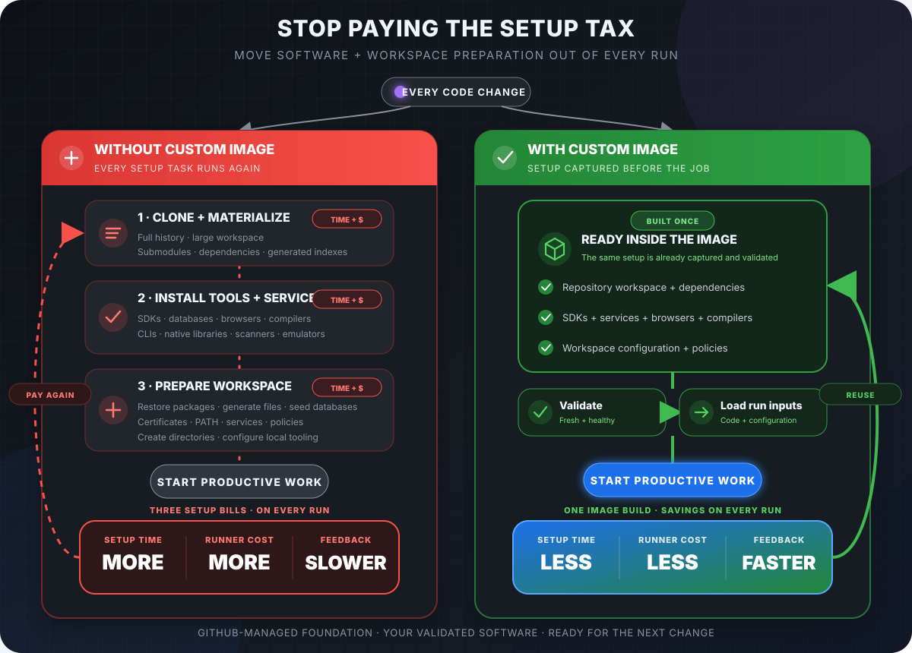
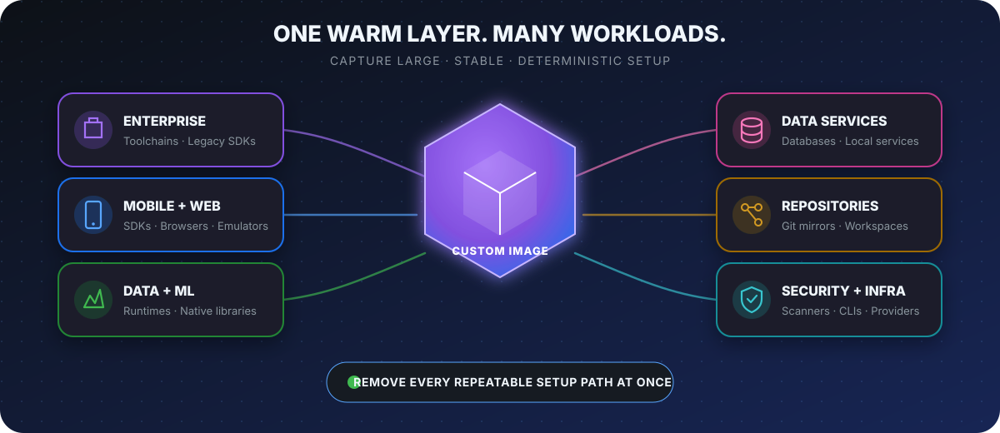
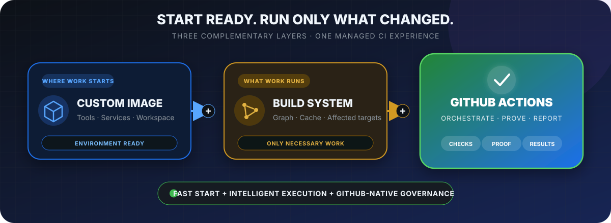
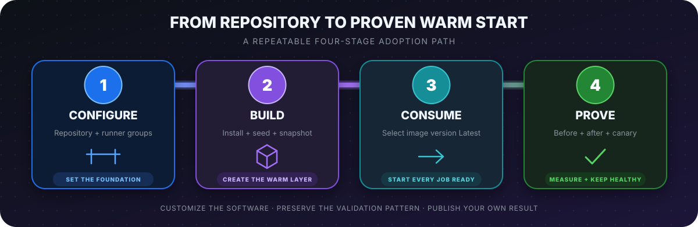
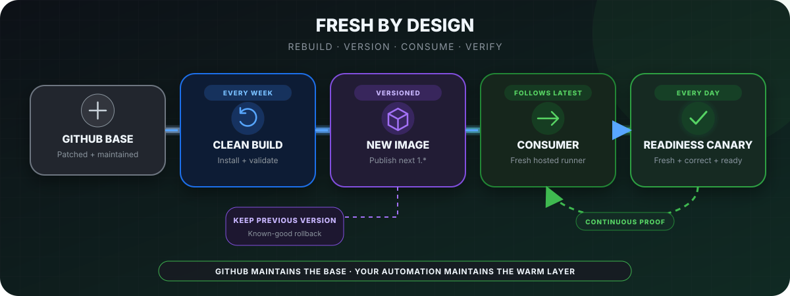

# ◈ Pre-warmed GitHub-hosted runners

### GitHub-managed foundation. Your software. Ready in seconds.

Move repeatable setup out of every workflow run and into a reusable custom
image—without operating a fleet of self-hosted runners.

<strong>Jump to a section</strong>

- [Why custom images](#-why-custom-images)
- [Where they create value](#-where-they-create-value)
- [How the layers fit](#-how-the-layers-fit)
- [Cost example](#-cost-example)
- [Measured proof](#-one-measured-implementation)
- [Use the template](#-use-this-repository-as-a-template)
- [Keep images current](#-keep-images-current)

---

## ↯ Why custom images

  

<table>
<tr>
<td align="center" width="33%"><strong>↯ START FASTER</strong> REMOVE REPEATED SETUP</td>
<td align="center" width="33%"><strong>◇ SPEND LESS</strong> STOP REBUILDING THE SAME ENVIRONMENT</td>
<td align="center" width="33%"><strong>✓ STAY CONSISTENT</strong> START FROM A VALIDATED FOUNDATION</td>
</tr>
</table>

> **GitHub manages the runner foundation. You add the warm layer.**

## ◆ Where they create value

  

Pre-warm work that is **large, stable, deterministic, slow to prepare, and safe
to capture**. Never bake secrets, production data, short-lived credentials, or
unlicensed software into an image.

| Put in the image | Keep dynamic |
|---|---|
| SDKs, compilers, services, browsers, approved tools, stable assets, prepared workspaces | Source changes, secrets, run-specific configuration, and frequently changing dependencies |

[Explore 14 workload examples and caching guidance →](docs/deep-dive.md#workload-examples)

## ◐ How the layers fit

  

| Layer | Optimizes |
|---|---|
| **Custom image** | Where work starts |
| **Nx, Bazel, Turborepo, or another build system** | What work runs |
| **GitHub Actions** | How work is orchestrated, proven, and reported |

Custom images do not replace intelligent caching, affected-target selection, or
test splitting. The strongest design combines the layers.

[Compare CI alternatives and the role of caches and artifacts →](docs/deep-dive.md#architecture-and-competitive-context)

## ◇ Cost example

Using this repository's measured POC and published runner rates:

| Runs / month | Standard Windows path | Custom-image path* |
|---:|---:|---:|
| 1,000 | $130.00 | **$26.67** |
| 10,000 | $1,300.00 | **$224.67** |
| 50,000 | $6,500.00 | **$1,104.67** |

* Example runner compute only: 13 billed standard Windows minutes versus one
billed 4-core Windows minute, plus $4.67/month observed image-build and canary
compute. Storage and plan allowances vary.

> Measure your own repository, software stack, volume, retention, and plan.
> Treat setup time as workflow time—not automatically as labor savings.

[Review the formula, rates, assumptions, and storage caveats →](docs/deep-dive.md#cost-methodology)

## ✓ One measured implementation

This repository pre-warms a Windows image with:

- SQL Server 2022 Developer
- A full-history `llvm/llvm-project` workspace
- 186,978 tracked files at one pinned commit

| Measured setup | Standard `windows-latest` | Custom image |
|---|---:|---:|
| Full-history checkout | 8 min 42 sec | **27 sec** |
| SQL Server ready | 3 min 24 sec | **0.27 sec** |
| **Ready for work** | **12 min 06 sec** | **28 sec** |

<table>
<tr>
<td align="center" width="33%"><strong>698.54 sec</strong> REMOVED</td>
<td align="center" width="33%"><strong>96.2%</strong> SETUP REDUCTION</td>
<td align="center" width="33%"><strong>26.1×</strong> FASTER</td>
</tr>
</table>

Both paths used fresh hosted VMs, checked out the same commit, reported the
same file count, and completed the same Git-to-SQL proof. This result
demonstrates the pattern; it is not a universal performance promise.

[Inspect exact timings, benchmark identity, and correctness gates →](docs/deep-dive.md#verified-benchmark-evidence)

## ⌘ Use this repository as a template

> [!IMPORTANT]
> Configure the image-generation and consumer runners, set
> `BENCHMARK_REPOSITORY`, then publish your own before/after result.

  

| Start here | Customize |
|---|---|
| [Image build](.github/workflows/build-custom-image.yml) | Install your software and prepare stable assets |
| [Before/after benchmark](.github/workflows/compare-before-after.yml) | Measure equivalent setup and proof paths |
| [Daily canary](.github/workflows/validate-custom-image.yml) | Validate freshness and real workload readiness |
| [PowerShell scripts](scripts) | Reuse timeout, sanitization, and proof patterns |

[Follow the exact runner setup and warm-checkout design →](docs/deep-dive.md#implementation-guide)

Community examples:
[`km-allthethings/build-custom-images`](https://github.com/km-allthethings/build-custom-images)

## ↻ Keep images current

  

This template performs a clean weekly rebuild from GitHub's current base image
and a daily consumer canary. Keep the current version plus one known-good
rollback version.

[Review promotion, rollback, retention, and security guardrails →](docs/deep-dive.md#operations-and-security)

---

### ◈ Build once · Validate continuously · Start every job ready

[Custom-image documentation](https://docs.github.com/en/enterprise-cloud@latest/actions/how-tos/manage-runners/larger-runners/use-custom-images)
· [Deep dive](docs/deep-dive.md)

