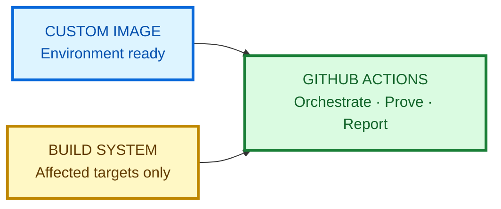
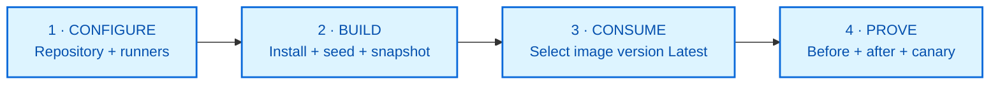

<div align="center">

# ◈ Pre-warmed GitHub-hosted runners

### GitHub-managed foundation. Your software. Ready in seconds.

[](https://docs.github.com/en/enterprise-cloud@latest/actions/how-tos/manage-runners/larger-runners/use-custom-images)
[](https://docs.github.com/en/enterprise-cloud@latest/actions/how-tos/manage-runners/larger-runners/use-custom-images)
[](#-one-measured-implementation)

Move repeatable setup out of every workflow run and into a reusable custom
image—without taking on a fleet of self-hosted runners.

</div>

---

## ↯ The custom-image advantage

### Move setup out of every run

<table>
<tr>
<th align="center" width="35%">○ WITHOUT CUSTOM IMAGE</th>
<th align="center" width="30%">◆ PREPARE ONCE</th>
<th align="center" width="35%">✓ WITH CUSTOM IMAGE</th>
</tr>
<tr>
<td align="center">
<h2>12 min 06 sec</h2>
<sub>CLONE EVERYTHING · INSTALL SOFTWARE</sub>
</td>
<td align="center">
<h2>Build once</h2>
<sub>GITHUB BASE · YOUR TOOLS · YOUR WORKSPACE</sub>
</td>
<td align="center">
<h2>28 sec</h2>
<sub>VALIDATE FRESHNESS · FETCH ONLY THE DELTA</sub>
</td>
</tr>
</table>

<table>
<tr>
<td align="center" width="33%">
<sub>SETUP TIME REMOVED / RUN</sub>
<h2>11 min 39 sec</h2>
</td>
<td align="center" width="33%">
<sub>FASTER TO READY</sub>
<h2>26.1×</h2>
</td>
<td align="center" width="33%">
<sub>MONTHLY COMPUTE / 1K RUNS*</sub>
<h2>$130 → $26.67</h2>
</td>
</tr>
</table>

> ### 96.2% less setup—without operating a self-hosted runner fleet.
>
> Keep the convenience of GitHub-hosted runners. Add the speed and consistency
> of your own pre-warmed environment.

| ◇ GitHub manages | ◆ Your team adds | ✓ Every job receives |
|---|---|---|
| Hosted infrastructure, clean environments, base runner images, and larger-runner scaling | Approved tools, services, repositories, dependencies, and configuration | A fresh, validated, ready-to-work environment |

<sub>
* Measured by this repository's POC. The 1,000-run estimate uses private
standard-Windows rates, one billed custom-image minute, and $4.67 monthly image
maintenance compute; storage excluded. Results vary by workload.
</sub>

Official sources:
[GitHub-hosted runners](https://docs.github.com/en/actions/reference/runners/github-hosted-runners) ·
[Larger runners](https://docs.github.com/en/enterprise-cloud@latest/actions/concepts/runners/larger-runners) ·
[Custom images](https://docs.github.com/en/enterprise-cloud@latest/actions/how-tos/manage-runners/larger-runners/use-custom-images)

## ◆ Where pre-warming creates value

| Workload | Put in the image | Remove from every job |
|---|---|---|
| **Enterprise toolchains** | Approved compilers, build workloads, internal CA certificates | Long bootstrap scripts and configuration drift |
| **Mobile builds** | Android SDKs, emulator images, device tooling | Large SDK and system-image downloads |
| **Browser testing** | Browser binaries, drivers, stable test assets | Repeated Playwright or browser installation |
| **Databases and services** | SQL engines, clients, local service configuration | Installer downloads, service setup, restarts |
| **Large repositories** | Git mirror, full history, materialized workspace | Multi-GB clone and file materialization |
| **Data and ML builds** | Runtimes, native libraries, approved model tooling | Heavy environment and native dependency setup |
| **Dependency-heavy builds** | Restored package stores and immutable build dependencies | Re-downloading stable packages on every run |
| **Embedded and IoT** | Cross-compilers, board SDKs, emulators, firmware tools | Rebuilding specialized device environments |
| **Game and graphics builds** | Engine SDKs, content tools, platform workloads | Very large editor, SDK, and asset-tool installation |
| **Security and compliance** | Approved scanners, SBOM tools, policy bundles | Installing and aligning security tooling in every job |
| **Infrastructure delivery** | Pinned cloud CLIs, Terraform providers, Helm plugins | Re-fetching approved deployment toolchains |
| **Documentation and localization** | TeX distributions, fonts, converters, language packs | Large document-tool and font installation |
| **Media processing** | Approved codecs, image/video tools, stable test media | Native package setup and repeated asset downloads |
| **Legacy modernization** | Compatibility SDKs, older runtimes, MSBuild workloads | Reconstructing fragile legacy build environments |

The best candidates are **large, stable, deterministic, and safe to capture**.
Do not bake secrets, production data, short-lived credentials, or unlicensed
software into an image.

> [!TIP]
> The gain compounds. If a workflow installs three slow components, a custom
> image can remove all three setup paths—not just optimize one command.

<details>
<summary><strong>Side note · Custom image, dependency cache, or artifact?</strong></summary>

These features solve different problems and work best as layers:

| Layer | Use it for | Expected behavior |
|---|---|---|
| **Custom image** | OS-level tools, SDKs, services, large stable assets, and validated configuration | Every runner starts with the same versioned foundation |
| **Dependency cache** | Package-manager stores, intermediate outputs, and expensive but regenerable files | A key may hit or miss; the job must still work after a miss |
| **Artifact** | Binaries, test results, logs, screenshots, and data passed between jobs | Preserve or share outputs produced by a workflow run |

### A practical layered strategy

1. Put **large, stable, slow-to-install** software in the custom image.
2. Cache **frequently changing, regenerable** dependencies using keys derived
   from the operating system, tool version, and lockfile.
3. Use ordered restore keys only when a broader, partially matching cache is
   safe and useful.
4. Measure cache download/extraction time; do not cache small data that is
   faster to regenerate or data already supplied efficiently by the image.
5. Upload final build outputs and diagnostics as artifacts—not caches.

> [!CAUTION]
> Treat restored cache contents as untrusted input. Never place secrets or
> sensitive data in a cache. Fork pull requests and other low-trust triggers
> have specific cache-access protections, but workflows should remain safe
> when a cache is missing or contains unexpected files.

Official GitHub guidance:

- [Dependency caching concepts](https://docs.github.com/en/actions/concepts/workflows-and-actions/dependency-caching)
- [Dependency caching reference and secure-use guidance](https://docs.github.com/en/actions/reference/workflows-and-actions/dependency-caching)
- [Workflow artifacts and how they differ from caches](https://docs.github.com/en/actions/concepts/workflows-and-actions/workflow-artifacts)
- [Using custom images](https://docs.github.com/en/enterprise-cloud@latest/actions/how-tos/manage-runners/larger-runners/use-custom-images)

</details>

## ◐ Before replacing GitHub Actions

<table>
<tr>
<th width="33%">WITHOUT CUSTOM IMAGES</th>
<th width="33%">WHY ALTERNATIVES APPEAL</th>
<th width="33%">GITHUB ACTIONS + CUSTOM IMAGES</th>
</tr>
<tr>
<td>Cold clone, tool installation, service setup, and dependency restoration repeat in every job.</td>
<td>Other platforms may offer self-managed execution, native test splitting, typed pipeline configuration, or parent-child orchestration.</td>
<td>Keep GitHub-hosted infrastructure while starting from your validated tools, services, dependencies, and workspace.</td>
</tr>
<tr>
<td>Standard runner resources may not match a large build's CPU, memory, disk, or concurrency needs.</td>
<td>Self-hosted fleets can provide specialized hardware and complete infrastructure control.</td>
<td>Larger runners add more resources, autoscaling, runner groups, and custom images without operating the runner fleet yourself.</td>
</tr>
<tr>
<td>CI YAML alone does not understand a monorepo's complete dependency graph.</td>
<td>Dynamic pipelines and specialized build systems can select only affected work.</td>
<td>Pair custom images with Nx, Bazel, Turborepo, or another graph-aware build system.</td>
</tr>
</table>

> **Custom images optimize where work starts. A monorepo build system
> optimizes what work runs. The strongest design uses both.**



<details>
<summary><strong>Competitive landscape for large monorepos</strong></summary>

| Platform | Particularly strong when | Tradeoff or GitHub Actions response |
|---|---|---|
| **Buildkite** | You want self-hosted agents and scripts that upload dynamic pipeline steps at runtime. | Your team provisions, scales, upgrades, and secures agent infrastructure. GitHub larger runners plus custom images preserve a managed execution model. |
| **CircleCI** | Historical test timing should split a suite across parallel containers automatically. | GitHub matrices provide parallel job variations, but timing-aware test distribution normally comes from the test framework or another tool. |
| **TeamCity** | Complex build chains and reusable configuration benefit from Kotlin DSL and IDE support. | GitHub reusable workflows reduce duplication and remain close to pull requests, checks, permissions, and repository governance. |
| **GitLab CI/CD** | Parent-child pipelines and change-based rules should organize independently defined areas of one repository. | GitHub supports path filters, matrices, and reusable workflows; graph-aware affected execution is usually delegated to the build-system layer. |

Official references:

- Buildkite:
  [Self-hosted agents](https://buildkite.com/docs/agent/self-hosted) ·
  [Dynamic pipelines](https://buildkite.com/docs/pipelines/configure/dynamic-pipelines)
- CircleCI:
  [Test splitting and parallelism](https://circleci.com/docs/guides/optimize/parallelism-faster-jobs/)
- TeamCity:
  [Kotlin DSL](https://www.jetbrains.com/help/teamcity/kotlin-dsl.html) ·
  [Build-chain dependencies](https://www.jetbrains.com/help/teamcity/configuring-dependencies.html)
- GitLab:
  [Downstream and child pipelines](https://docs.gitlab.com/ci/pipelines/downstream_pipelines/) ·
  [Pipeline architecture](https://docs.gitlab.com/ci/pipelines/pipeline_architectures/)
- GitHub:
  [Larger runners](https://docs.github.com/en/actions/concepts/runners/larger-runners) ·
  [Reusable workflows](https://docs.github.com/en/actions/how-tos/reuse-automations/reuse-workflows) ·
  [Matrix jobs](https://docs.github.com/en/actions/how-tos/write-workflows/choose-what-workflows-do/run-job-variations)
- Monorepo build systems:
  [Nx affected](https://nx.dev/docs/features/ci-features/affected) ·
  [Bazel remote caching](https://bazel.build/remote/caching) ·
  [Turborepo CI](https://turborepo.dev/docs/crafting-your-repository/constructing-ci)

</details>

## ◇ Model the value with your own workload

```text
monthly runner cost =
  workflow runs
  × billed minutes per run
  × runner rate
  + image-build and validation compute
  + retained image storage
```

Measure the current job first, build the image, then compare equivalent
outcomes. A strong business case uses your repository, software stack, workflow
volume, retention policy, and GitHub plan—not a generic labor-cost multiplier.

### Example scale from this repository's POC

| Runs / month | Standard Windows path | Custom-image path* |
|---:|---:|---:|
| 1,000 | **$130.00** | **$26.67** |
| 10,000 | **$1,300.00** | **$224.67** |
| 50,000 | **$6,500.00** | **$1,104.67** |

<sub>
* Uses this POC's measured 13 billed minutes versus one billed minute, plus
$4.67/month for weekly image-build and daily-canary compute. Assumes private
standard Windows minutes are billable after plan allowances. Storage varies by
image size, retention, and plan allowance.
</sub>

<details>
<summary><strong>How the example costs are calculated</strong></summary>

This is a runner-compute example, not a forecast of a customer's final invoice.

| 1,000-run example | Calculation | Monthly cost |
|---|---|---:|
| Standard Windows path | 1,000 × 13 billed min × $0.010 | **$130.00** |
| Custom-image path | 1,000 × 1 billed min × $0.022 + $4.67 | **$26.67** |

The rates come from
[GitHub's Actions runner pricing](https://docs.github.com/en/enterprise-cloud@latest/billing/reference/actions-runner-pricing).
GitHub rounds each job up to a whole billed minute.

The fixed **$4.67/month** is the observed compute for weekly image builds and
the daily canary. It is spread across more runs as workflow volume grows.
Included private minutes can reduce the standard-runner cost.

Custom-image storage is separate. Apply the retained image size, retention
window, and allowance for your plan in the
[GitHub pricing calculator](https://github.com/pricing/calculator?feature=actions)
or billing dashboard. See
[custom-image storage billing](https://docs.github.com/en/enterprise-cloud@latest/billing/concepts/product-billing/github-actions#custom-image-storage).

</details>

## ✓ One measured implementation

This repository includes one concrete POC—not the limit of what the template
can support:

> **Pre-warm a Windows image with SQL Server and a large monorepo workspace.**

The benchmark uses
[`llvm/llvm-project`](https://github.com/llvm/llvm-project) with full history
and **186,978 tracked files**. Both paths resolve the same commit and execute
the same Git-to-SQL proof workload.

| Measured setup | Standard `windows-latest` | Custom image |
|---|---:|---:|
| Full-history checkout | 8 min 42 sec | **27 sec** |
| SQL Server ready | 3 min 24 sec | **0.27 sec** |
| **Ready for work** | **12 min 06 sec** | **28 sec** |

<details>
<summary><strong>Verified evidence · exact timings and correctness checks</strong></summary>

### Benchmark identity

| Evidence | Value |
|---|---|
| Source repository | `llvm/llvm-project` |
| Commit | `b1dd93c6af666442840896e0f30c1506e587b6db` |
| Tracked files | 186,978 |
| Custom image | `windows-monorepo-sqlserver` version `1.1.0` |
| Source run | `38083459558` |

### Exact measured timings

| Phase | Standard runner | Custom image |
|---|---:|---:|
| Activate prepared worktree | — | **0.14 sec** |
| `actions/checkout` | **521.95 sec** | **26.73 sec** |
| Complete checkout path | **521.95 sec** | **26.87 sec** |
| SQL Server setup/readiness | **203.51 sec** | **0.27 sec** |
| **Ready for dependent work** | **726.33 sec** | **27.79 sec** |
| Git-to-SQL proof workload | **1.57 sec** | **0.35 sec** |

### Correctness gates

- Both jobs checked out the exact same pinned commit.
- Both jobs reported the same 186,978 tracked files.
- Both jobs inserted the Git evidence into SQL Server and queried it back.
- Both jobs started on fresh GitHub-hosted VMs; no previous run warmed either
  machine.
- Queue time, VM provisioning, and the small tooling checkout were excluded
  from the setup timer.

</details>

This result demonstrates the pattern; it is not a promise that every workload
will become 26.1× faster. Add your software, retain the same before/after proof,
and publish your own measured result.

## ⌘ Use this repository as a template



| Template component | What to customize |
|---|---|
| [Image build](.github/workflows/build-custom-image.yml) | Add your installers, SDKs, services, and immutable assets |
| [Before/after benchmark](.github/workflows/compare-before-after.yml) | Replace or extend the measured setup phases |
| [Daily canary](.github/workflows/validate-custom-image.yml) | Prove image age, software readiness, and real workload behavior |
| [PowerShell scripts](scripts) | Reuse the timeout, validation, sanitization, and proof patterns |

> [!NOTE]
> **More community examples:** the
> [`km-allthethings/build-custom-images`](https://github.com/km-allthethings/build-custom-images)
> repository includes Ubuntu and Windows image workflows, proxy configuration,
> pre/post-job hooks, and container-hook examples. It is a community resource,
> not official GitHub documentation; review its security and operational
> choices against your own requirements.

The current template defaults to `llvm/llvm-project`. Set
`BENCHMARK_REPOSITORY` to your own `owner/repository`, then rebuild the image.

<details>
<summary><strong>Exact runner setup</strong></summary>

Custom images require GitHub-hosted larger runners created at organization or
enterprise scope.

### Image-generation runner

Create a Windows x64 GitHub-hosted larger runner:

| Setting | Value |
|---|---|
| Base image | GitHub-owned `windows-latest` |
| Generate custom images | Enabled |
| Name | `windows-image-generation` |

Run **Build Windows monorepo image**. It publishes:

```text
windows-monorepo-sqlserver
```

GitHub may continue provisioning the image after the workflow completes. See
[Generating a custom image](https://docs.github.com/en/enterprise-cloud@latest/actions/how-tos/manage-runners/larger-runners/use-custom-images#generating-a-custom-image).

### Consumer runner

Create a second Windows x64 larger runner:

| Setting | Value |
|---|---|
| Image | Custom → `windows-monorepo-sqlserver` |
| Version | **Latest** |
| Size | 4 cores, 16 GB RAM, 150 GB SSD |
| Name | `windows-monorepo-sqlserver-runner` |

Selecting
[**Latest**](https://docs.github.com/en/enterprise-cloud@latest/actions/how-tos/manage-runners/larger-runners/use-custom-images#installing-custom-images)
adopts newly published versions. Pin a version only for intentional rollback.

| Optional setting | Purpose |
|---|---|
| `IMAGE_GENERATION_RUNNER` | Override the image-generation runner name |
| `CUSTOM_IMAGE_RUNNER` | Override the consumer runner name |
| `BENCHMARK_REPOSITORY` | Replace `llvm/llvm-project` |
| `BENCHMARK_TOKEN` | Read-only token for a private benchmark repository |
| `CUSTOM_IMAGE_MAX_AGE_DAYS` | Override the default 10-day freshness limit |

</details>

<details>
<summary><strong>How the warm Git checkout works</strong></summary>

The image contains:

```text
C:\ProgramData\GitHubCustomImage\repository.git
C:\ProgramData\GitHubCustomImage\worktree
```

At runtime, `Initialize-WarmCheckout.ps1` moves the prepared worktree into
`GITHUB_WORKSPACE` on the same disk. `actions/checkout` still authenticates,
fetches current refs, and force-checks the pinned target SHA.

The custom path uses `clean: false` because the image build already proves the
worktree is clean and each hosted runner VM is fresh. A metadata-only detached
`HEAD` avoids rescanning every tracked file before checkout.

The build uses `persist-credentials: false` and scans both cached repositories
for authentication headers or token markers before snapshotting.

</details>

## ↻ Keep the warm layer current


GitHub maintains the base image; your scheduled workflow must rebuild and
revalidate the custom layer. This template performs a clean weekly rebuild and
a daily consumer canary.

<details>
<summary><strong>Promotion, rollback, and retention</strong></summary>

- The build publishes automatically incremented `1.*` versions.
- The consumer runner follows **Latest**.
- For rollback, pin the previous known-good version and run the canary.
- Return to **Latest** after remediation.
- Keep at least one compatible rollback version.

The build intentionally does not delete the previous image immediately:
provisioning is asynchronous and the new version must first pass the consumer
canary. A 14-day retention window is a practical starting point for weekly
builds. Configure a
[custom-image retention policy](https://docs.github.com/en/enterprise-cloud@latest/admin/enforcing-policies/enforcing-policies-for-your-enterprise/enforcing-policies-for-github-actions-in-your-enterprise#custom-images-retention-policies).

</details>

<details>
<summary><strong>Security and benchmark guardrails</strong></summary>

- Never capture secrets, production data, long-lived credentials, or
  unlicensed software.
- Use a dedicated runner group for image generation.
- Keep workflow permissions read-only where possible.
- Validate software and credential hygiene before snapshotting.
- Start both benchmark paths on fresh VMs.
- Resolve one commit, require equal file counts, and execute the same proof.
- Treat setup time as workflow time—not automatically as labor savings.

See GitHub's
[custom-image security guidance](https://docs.github.com/en/enterprise-cloud@latest/actions/how-tos/manage-runners/larger-runners/use-custom-images#security-best-practices-for-custom-images).

</details>

<details>
<summary><strong>Official documentation</strong></summary>

- [Using custom images](https://docs.github.com/en/enterprise-cloud@latest/actions/how-tos/manage-runners/larger-runners/use-custom-images)
- [GitHub-hosted runners reference](https://docs.github.com/en/actions/reference/runners/github-hosted-runners)
- [Larger runners](https://docs.github.com/en/enterprise-cloud@latest/actions/concepts/runners/larger-runners)
- [Runner pricing](https://docs.github.com/en/enterprise-cloud@latest/billing/reference/actions-runner-pricing)
- [Custom-image storage](https://docs.github.com/en/enterprise-cloud@latest/billing/concepts/product-billing/github-actions#custom-image-storage)
- [Custom-image retention policies](https://docs.github.com/en/enterprise-cloud@latest/admin/enforcing-policies/enforcing-policies-for-your-enterprise/enforcing-policies-for-github-actions-in-your-enterprise#custom-images-retention-policies)

</details>

---

<div align="center">

### ◈ Build the environment once · Start every job ready

</div>
