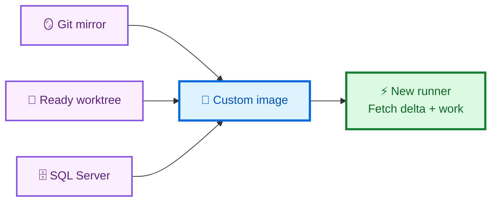
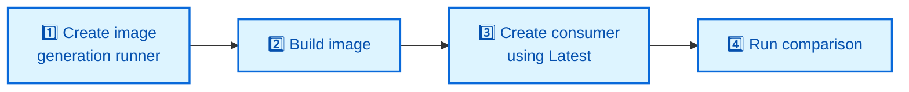

<div align="center">

# 🚀 GitHub Actions Custom Images

### Build the slow parts once. Start every job ready.

[](https://github.com/actions/runner-images)
[](https://docs.github.com/en/enterprise-cloud@latest/actions/how-tos/manage-runners/larger-runners/use-custom-images)
[](https://learn.microsoft.com/sql/database-engine/install-windows/install-sql-server)

**Example 01 · Large monorepo checkout + SQL Server**

[See the result](#-verified-result) ·
[How it works](#-how-it-works) ·
[Run it](#-run-it)

</div>

---

## 🏆 Verified result

<table>
<tr>
<td align="center" width="33%">
<strong>⏱️ READY FOR WORK</strong><br/><br/>
<strong>12 min 06 sec → 28 sec</strong>
</td>
<td align="center" width="33%">
<strong>📉 LESS SETUP</strong><br/><br/>
<strong>96.2%</strong>
</td>
<td align="center" width="33%">
<strong>⚡ FASTER</strong><br/><br/>
<strong>26.1×</strong>
</td>
</tr>
</table>

| | 🔴 Standard `windows-latest` | 🟢 Custom image |
|---|---:|---:|
| Git checkout | 8 min 42 sec | **27 sec** |
| SQL Server ready | 3 min 24 sec | **0.27 sec** |
| **Total setup** | **12 min 06 sec** | **28 sec** |

> **11 min 39 sec returned to the feedback loop on every run.**

[View canonical benchmark run 38083459558 →](https://github.com/tsvi-solutions/custom_images_examples/actions/runs/38083459558)

<sub>
LLVM at commit <code>b1dd93c6af666442840896e0f30c1506e587b6db</code> ·
186,978 tracked files · custom image <code>1.1.0</code>
</sub>

## 🎯 What changed?

| 🔴 Every standard job | 🟣 Build once into the image | 🟢 Every custom-image job |
|---|---|---|
| Download full Git history | Credential-free Git mirror | Activate prepared worktree |
| Materialize ~187K files | Clean materialized worktree | Fetch only the latest delta |
| Download SQL media | SQL Server 2022 Developer | Query SQL Server immediately |
| Install and configure SQL | Weekly GitHub snapshot | Start useful work |

## 🧠 How it works



The image stores the expensive, stable setup. Each job still uses
`actions/checkout`, authenticates normally, resolves the latest source
revision, and downloads changes made since the image was built.

<details>
<summary><strong>Why the warm checkout is safe and fast</strong></summary>

The image contains:

```text
C:\ProgramData\GitHubCustomImage\repository.git
C:\ProgramData\GitHubCustomImage\worktree
```

At runtime, `Initialize-WarmCheckout.ps1` moves the prepared worktree into
`GITHUB_WORKSPACE` on the same disk. It normalizes the remote URL and detaches
`HEAD` with a metadata-only ref update so `actions/checkout` does not rescan
every file before fetching.

The custom path uses `clean: false` because:

1. the image build already proves the worktree is clean;
2. every GitHub-hosted runner starts on a fresh ephemeral VM; and
3. `actions/checkout` still force-checks the pinned target SHA.

The build uses `persist-credentials: false` and scans both cached Git
repositories for authentication headers or token markers before snapshotting.

</details>

## 🏃 Run it



1. Create a Windows x64 **image-generation larger runner** named
   `windows-image-generation`.
2. Run **Build Windows monorepo image**.
3. Create a 4-core Windows larger runner named
   `windows-monorepo-sqlserver-runner`; select the new custom image and
   version **Latest**.
4. Run **Compare before and after custom image**.

> [!IMPORTANT]
> Create both runners from **organization settings**. Custom images require
> GitHub-hosted larger runners and cannot run on the standard
> `windows-latest` label.

<details>
<summary><strong>Exact runner and repository setup</strong></summary>

### 1. Image-generation runner

Open:

```text
https://github.com/organizations/YOUR-ORGANIZATION/settings/actions/runners
```

Choose **New runner → New GitHub-hosted runner**:

| Setting | Value |
|---|---|
| Platform | Windows x64 |
| Base image | GitHub-owned `windows-latest` |
| Generate custom images | Enabled |
| Name | `windows-image-generation` |

If you use another name, set the `IMAGE_GENERATION_RUNNER` Actions variable.
Enable custom images in the
[organization or enterprise Actions policy](https://docs.github.com/en/enterprise-cloud@latest/admin/enforcing-policies/enforcing-policies-for-your-enterprise/enforcing-policies-for-github-actions-in-your-enterprise#custom-images).

Run **Build Windows monorepo image**. The workflow publishes:

```text
windows-monorepo-sqlserver
```

GitHub may continue provisioning the image after the workflow finishes. See
[Generating a custom image](https://docs.github.com/en/enterprise-cloud@latest/actions/how-tos/manage-runners/larger-runners/use-custom-images#generating-a-custom-image).

### 2. Consumer runner

Create a second GitHub-hosted larger runner:

| Setting | Value |
|---|---|
| Platform | Windows x64 |
| Image | Custom → `windows-monorepo-sqlserver` |
| Version | **Latest** |
| Size | 4 cores, 16 GB RAM, 150 GB SSD |
| Maximum concurrency | 1 |
| Name | `windows-monorepo-sqlserver-runner` |

If you use another name, set the `CUSTOM_IMAGE_RUNNER` Actions variable.
Selecting
[**Latest**](https://docs.github.com/en/enterprise-cloud@latest/actions/how-tos/manage-runners/larger-runners/use-custom-images#installing-custom-images)
lets the runner adopt newly published versions. Pin a version only for a
deliberate rollback.

### 3. Optional benchmark settings

| Setting | Required | Purpose |
|---|:---:|---|
| `BENCHMARK_REPOSITORY` variable | No | Defaults to `llvm/llvm-project` |
| `BENCHMARK_TOKEN` secret | Private repositories only | Read-only Contents token |
| `CUSTOM_IMAGE_MAX_AGE_DAYS` variable | No | Defaults to 10 days |

Changing `BENCHMARK_REPOSITORY` requires rebuilding the image.

</details>

## 💵 Time and money

| Scenario | Result per run |
|---|---:|
| Same Windows 4-core runner before vs. after | **$0.264 compute saved** |
| This public demo: free standard runner vs. paid larger runner | **$0.022 added cost** |
| Engineering capacity at $100/hour and 25% blocked time | **$4.85 recovered** |

> [!WARNING]
> Custom-image storage is billed separately and is not included above.
> Recovered engineering capacity is not guaranteed payroll reduction.

<details>
<summary><strong>Cost assumptions and break-even calculation</strong></summary>

As of October 10, 2026, a Windows 4-core larger runner costs
[$0.022/minute](https://docs.github.com/en/enterprise-cloud@latest/billing/reference/actions-runner-pricing),
and each job rounds up to a whole minute.

| Comparison | Cold | Custom | Difference |
|---|---:|---:|---:|
| Same 4-core larger runner | $0.286 | $0.022 | **$0.264 saved** |
| Private standard Windows after included minutes | $0.130 | $0.022 | **$0.108 saved** |
| Public repository used by this demo | $0.000 | $0.022 | **$0.022 added** |

The observed weekly image build costs about **$4.00/month** and the daily
canary about **$0.67/month**. Maintenance compute therefore breaks even at
approximately **18 equivalent 4-core jobs/month**, before storage.

```text
engineering capacity value =
  time saved in hours
  × loaded hourly cost
  × genuinely blocked fraction
  × affected developers
  × workflow runs
```

| Blocked fraction at $100/hour | Capacity value/run |
|---:|---:|
| 25% | **$4.85** |
| 50% | **$9.70** |
| 100% | **$19.40** |

Custom-image storage accrues by retained GB-hours. Apply the rate and included
allowance shown in the
[GitHub pricing calculator](https://github.com/pricing/calculator?feature=actions)
or your billing dashboard. See
[Custom-image storage billing](https://docs.github.com/en/enterprise-cloud@latest/billing/concepts/product-billing/github-actions#custom-image-storage).

</details>

## 🔄 Stays fresh automatically


- **Sunday 03:17 UTC:** rebuild from GitHub's current `windows-latest`.
- **Daily 09:47 UTC:** verify image age, warm checkout, SQL Server, and the
  combined Git-to-SQL workload.
- **Retention:** keep the current version and one known-good rollback version.

<details>
<summary><strong>Lifecycle, rollback, and retention details</strong></summary>

A clean weekly rebuild refreshes Windows, SQL Server media, Git history, and
the prepared worktree. Building indefinitely from older custom images is
avoided because
[derived images inherit the expiration of their base image](https://docs.github.com/en/enterprise-cloud@latest/actions/how-tos/manage-runners/larger-runners/use-custom-images#expiration-for-images-built-from-custom-images).

Every successful `snapshot` creates a version. The workflow uses
`version: "1.*"` and the consumer follows **Latest**.

For rollback:

1. Edit `windows-monorepo-sqlserver-runner`.
2. Change **Latest** to the previous known-good version.
3. Run the canary.
4. Return to **Latest** after the issue is fixed.

The build workflow intentionally does not delete the previous version because
image provisioning is asynchronous and the new version has not yet passed the
consumer canary. A **14-day maximum version age** is a practical starting point
for weekly builds. Configure a
[custom-image retention policy](https://docs.github.com/en/enterprise-cloud@latest/admin/enforcing-policies/enforcing-policies-for-your-enterprise/enforcing-policies-for-github-actions-in-your-enterprise#custom-images-retention-policies).

</details>

## 📁 Explore

| Start here | Purpose |
|---|---|
| [Build image workflow](.github/workflows/build-custom-image.yml) | Install, seed, validate, snapshot |
| [Comparison workflow](.github/workflows/compare-before-after.yml) | Measure cold and custom-image paths |
| [Daily canary](.github/workflows/validate-custom-image.yml) | Validate freshness and readiness |
| [PowerShell scripts](scripts) | Install SQL, activate Git, and prove the workload |

<details>
<summary><strong>Benchmark fairness and proof</strong></summary>

Each comparison is self-contained:

1. Resolve the benchmark repository's latest `HEAD` once.
2. Start both jobs on fresh GitHub-hosted VMs.
3. Check out the same pinned SHA with full history.
4. Require the same tracked-file count.
5. Insert the Git evidence into SQL Server and query it back.

The timer excludes queue and runner-provisioning time. It includes the work the
image removes: benchmark checkout and SQL Server readiness.

No previous workflow run warms the next run. The prepared worktree is inside
the custom image.

Enable the comparison workflow's optional telemetry input to collect CPU,
memory, disk, network, and process evidence with the
[Runner Telemetry Action](https://github.com/marketplace/actions/runner-telemetry-action).

</details>

<details>
<summary><strong>Security guardrails</strong></summary>

- Never bake secrets, access tokens, production data, or long-lived
  credentials into an image.
- Use a dedicated runner group for image generation.
- Keep runtime permissions read-only where possible.
- Use `persist-credentials: false` for repositories captured in the image.
- Scan cached Git configuration before snapshotting.
- Treat SQL Server Developer as development and CI software.
- Create mutable test databases at job runtime, not in the image.

See GitHub's
[security best practices for custom images](https://docs.github.com/en/enterprise-cloud@latest/actions/how-tos/manage-runners/larger-runners/use-custom-images#security-best-practices-for-custom-images)
and
[`GITHUB_TOKEN` guidance](https://docs.github.com/en/enterprise-cloud@latest/actions/security-for-github-actions/security-guides/automatic-token-authentication).

</details>

<details>
<summary><strong>Official documentation</strong></summary>

- [Use custom images](https://docs.github.com/en/enterprise-cloud@latest/actions/how-tos/manage-runners/larger-runners/use-custom-images)
- [GitHub-hosted larger runners](https://docs.github.com/en/enterprise-cloud@latest/actions/concepts/runners/larger-runners)
- [Actions runner pricing](https://docs.github.com/en/enterprise-cloud@latest/billing/reference/actions-runner-pricing)
- [Custom-image storage](https://docs.github.com/en/enterprise-cloud@latest/billing/concepts/product-billing/github-actions#custom-image-storage)
- [Custom-image retention policies](https://docs.github.com/en/enterprise-cloud@latest/admin/enforcing-policies/enforcing-policies-for-your-enterprise/enforcing-policies-for-github-actions-in-your-enterprise#custom-images-retention-policies)
- [Scheduled workflow events](https://docs.github.com/en/enterprise-cloud@latest/actions/reference/workflows-and-actions/events-that-trigger-workflows#schedule)
- [SQL Server unattended installation](https://learn.microsoft.com/sql/database-engine/install-windows/install-sql-server-from-the-command-prompt)

</details>

---

<div align="center">

### Build once · Validate once · Start ready

</div>
