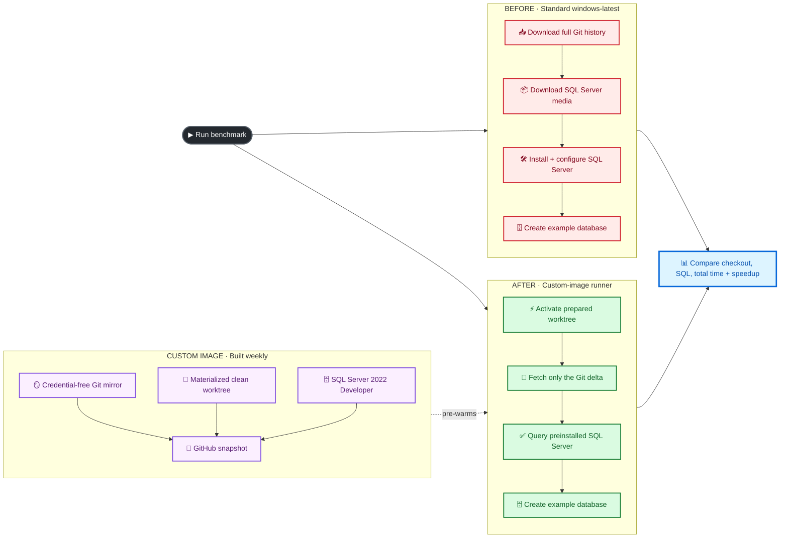
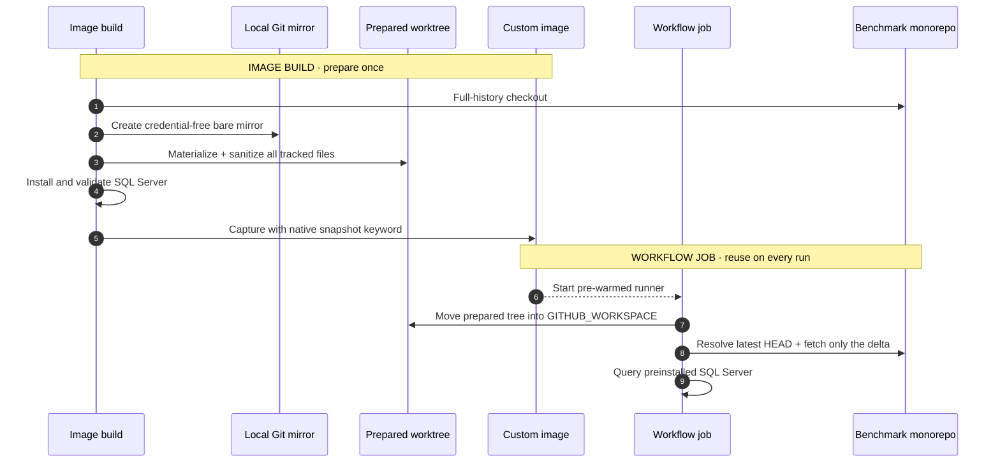
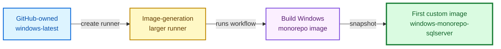

<div align="center">

# 🚀 GitHub Actions Custom Images

### Turn slow, repetitive runner setup into a fast, ready-to-work environment

[](https://github.com/actions/runner-images)
[](https://docs.github.com/en/enterprise-cloud@latest/actions/how-tos/manage-runners/larger-runners/use-custom-images)
[](https://learn.microsoft.com/sql/database-engine/install-windows/install-sql-server)
[](https://docs.github.com/en/enterprise-cloud@latest/actions/how-tos/manage-runners/larger-runners/use-custom-images)

**Example 01 · Large monorepo checkout + preinstalled SQL Server**

[View the verified result](#-verified-result) ·
[Understand the economics](#-time-saved-and-cost-impact) ·
[See how it works](#-how-the-warm-checkout-works) ·
[Run the demo](#-run-the-demo) ·
[Explore the implementation](#-explore-the-implementation)

</div>

---

## ✨ Why custom images?

Every minute spent rebuilding the same environment is a minute that every
workflow run—and every developer waiting on it—pays again.

| Without a custom image | With a custom image |
|---|---|
| 📥 Download history and materialize every file | ⚡ Reuse Git objects and an already-materialized worktree |
| 📦 Download SQL Server installation media | ✅ SQL Server is already installed |
| 🛠️ Run unattended installation and configuration | 🟢 Start the service and query it |
| ⏳ Repeat the work in every job | 🎯 Fetch only changes since the image build |
| 🌐 Depend heavily on network throughput | 💾 Shift stable dependencies to the image |

> [!TIP]
> The value is not merely “a faster VM.” A custom image removes deterministic,
> repeated setup work from the critical path of every job.

## 🎯 The centerpiece: before vs. after

This example compares two jobs that produce the **same outcome**:

- a complete Git checkout with full history; and
- a running SQL Server instance containing an empty `CustomImageExample`
  database.



### ✅ Verified result

The prepared-worktree comparison used custom image `1.1.0` and ran against
`llvm/llvm-project` at commit
`b1dd93c6af666442840896e0f30c1506e587b6db` with **186,978 tracked files**:

| Measurement | 🔴 Before: `windows-latest` | 🟢 After: custom image | Improvement |
|---|---:|---:|---:|
| Full-history checkout | 8 min 42 sec | 0 min 27 sec | 8 min 15 sec saved |
| SQL Server setup/readiness | 3 min 24 sec | 0 min 0.27 sec | 3 min 23 sec saved |
| **Ready to execute dependent commands** | **12 min 06 sec** | **0 min 28 sec** | **11 min 39 sec saved** |
| Git + SQL proof workload | 0 min 1.57 sec | 0 min 0.35 sec | Both passed |

> **96.2% less setup time · 26.1× faster to a usable runner**

[View the successful benchmark run →](https://github.com/tsvi-solutions/custom_images_examples/actions/runs/38083459558)

> [!NOTE]
> **Run
> [38083459558](https://github.com/tsvi-solutions/custom_images_examples/actions/runs/38083459558)
> is the canonical example used throughout this README.** The timing, speedup,
> compute-cost, and engineering-capacity figures below all derive from its
> measured outputs. It is not a hand-calculated or synthetic result.

The image cache activated in **0.14 seconds**. The remaining 26.73-second
checkout action fetched current refs and updated the prepared tree from its
image-cached commit to the latest pinned commit. No previous workflow run
warms this state: every GitHub-hosted job starts on a newly provisioned VM from
the image.

The benchmark does **not** inflate this example repository with generated
files. By default, it performs a real full-history checkout of
[`llvm/llvm-project`](https://github.com/llvm/llvm-project), a substantial
public monorepo. Set the `BENCHMARK_REPOSITORY` repository or organization
variable to use a different `owner/repository`, including your own
representative monorepo.

Actual numbers depend on repository size, repository growth, image freshness,
runner size, and network conditions. The workflow reports real measurements
instead of promising a synthetic “5-minute to 5-second” result.

### 🔁 What stays consistent between runs

Each dispatch is one self-contained experiment—not the second half of a
two-run warm-up:

1. Resolve the benchmark repository's latest `HEAD` once.
2. Start **Before** on a fresh standard `windows-latest` VM.
3. Start **After** in parallel on a fresh VM from the latest ready custom image.
4. Check out the same pinned SHA and count the same tracked files on both.
5. Prove Git and SQL Server work together, then publish one comparison.

No runner state survives into the next workflow run. The optimized path is
repeatable because the prepared tree is part of the image, not because a
previous job warmed a machine. An incompatible old image fails rather than
silently falling back to the slow object-only path.

The exact durations will still move with repository churn, network and disk
conditions, SQL download speed on the baseline, and updates to
`windows-latest`. Expect the same **shape**—minutes before and seconds after—not
identical stopwatch values. For formal benchmarking, run the workflow at least
three times and report the median with links to every source run.

## 💵 Time saved and cost impact

As of **October 10, 2026**, GitHub lists the Windows 4-core larger-runner rate as
**$0.022/minute**, and
[rounds every job up to a whole
minute](https://docs.github.com/en/enterprise-cloud@latest/billing/reference/actions-runner-pricing).
The verified run's standard job lasted 12 min 25 sec (**13 billable minutes**);
the complete custom-image job lasted 39 sec (**1 billable minute**).

| Cost scenario for one equivalent job | Cold setup | Custom image | Direct compute impact |
|---|---:|---:|---:|
| Same Windows 4-core larger runner at $0.022/min | $0.286 | $0.022 | **$0.264 saved per run · 92.3%** |
| Private standard Windows after included minutes at $0.010/min | $0.130 | $0.022 | **$0.108 saved per run · 83.1%** |
| This public demo repository | $0.000 | $0.022 | **$0.022 additional direct cost** |

> [!IMPORTANT]
> Standard GitHub-hosted runners are free for public repositories, but
> [larger runners are always
> billed](https://docs.github.com/en/enterprise-cloud@latest/actions/concepts/runners/larger-runners#billing)—including
> in public repositories and when plan minutes remain. The public demo proves
> engineering-time savings; it does not claim that a paid larger runner is
> cheaper than a free public runner.

> [!TIP]
> **Faster feedback can outweigh runner price.** This public demo adds $0.022
> of direct runner cost but returns a usable environment 11 min 39 sec sooner.
> At an illustrative $100/hour, even a 25% genuinely blocked-time factor
> represents **$4.85 of recovered engineering capacity per run**.

> [!WARNING]
> **Custom-image storage is not included in the dollar savings above.** Compute
> savings, image-build and canary cost, storage cost, and recovered engineering
> capacity are separate lines. Use the retained GB-hours shown in your billing
> dashboard before claiming net cash savings.

<details>
<summary><strong>Show the detailed ROI model, maintenance break-even, and storage assumptions</strong></summary>

### Faster feedback loops can dominate runner cost

Runner price is only one part of CI economics. This run returned a usable
environment **11 min 39 sec sooner**. That can mean:

- earlier test, build, and deployment feedback;
- less developer context switching while waiting for CI;
- faster pull-request iteration and review;
- more jobs completed with the same concurrency limit;
- shorter recovery loops when a release or production fix is urgent.

The marginal custom-runner cost in this public demo is **$0.022**. At a loaded
engineering cost of $100/hour, recovering even **0.8 seconds** of otherwise
blocked developer time covers that runner charge. The measured feedback-loop
improvement is 699 seconds.

Use an explicit blocked-time factor rather than assuming every saved CI minute
becomes cash:

```text
engineering capacity value =
  time saved in hours
  × loaded engineering cost per hour
  × percentage of CI time that truly blocks useful work
  × affected developers
  × workflow runs
```

For this run, one developer, and an illustrative loaded cost of **$100/hour**:

| Portion of CI wait that blocks useful work | Capacity recovered per run | Capacity value per run | Value across 100 runs |
|---:|---:|---:|---:|
| 25% | 2 min 55 sec | **$4.85** | **$485** |
| 50% | 5 min 50 sec | **$9.70** | **$970** |
| 100% | 11 min 39 sec | **$19.40** | **$1,940** |

These figures represent recovered engineering capacity, not a guaranteed
reduction in payroll. Teams that can productively switch tasks should use a
lower blocked-time factor. Teams with several developers waiting on the same
required check, release, or incident fix may use a higher affected-developer
count. Keep infrastructure cost and capacity value as separate lines so the
business case remains auditable.

The apples-to-apples value appears when an organization already needs the
larger runner or pays for private-repository Windows minutes:

| Equivalent jobs per month | Gross 4-core larger-runner savings | After observed build + canary compute* |
|---:|---:|---:|
| 25 | $6.60 | **$1.93** before storage |
| 100 | $26.40 | **$21.73** before storage |
| 1,000 | $264.00 | **$259.33** before storage |

<sub>*The latest successful image build ran for 41 min 19 sec, rounded to 42
billable minutes: **$0.924**. At an average 4.33 weekly builds per month, that
is approximately **$4.00/month**. A sub-minute daily canary rounds to one
minute, approximately **$0.67/month**. Combined observed maintenance compute:
approximately **$4.67/month**.</sub>

At these measurements, maintenance compute breaks even at approximately
**18 equivalent 4-core larger-runner jobs per month**, before storage. Use this
formula with your own cadence and job duration:

```text
monthly net savings =
  (runs × per-run compute savings)
  - scheduled image-build cost
  - canary cost
  - custom-image storage overage
```

### Other costs to include

| Cost | How it behaves |
|---|---|
| **Custom-image storage** | Billed separately using retained GB-hours. One version is 150 GB; the current two versions total 300 GB. |
| **Included storage** | GitHub Team includes 75 GB and GitHub Enterprise Cloud includes 150 GB of custom-image storage. |
| **Current storage above allowance** | If two 150 GB versions remain for a full month: 225 GB-months above Team or 150 GB-months above Enterprise Cloud. |
| **Retention** | Every successful snapshot adds a version. Short retention lowers storage but reduces the rollback window. |
| **Failed or repeated jobs** | Runner time consumed before failure is still billable; GitHub rounds each job separately. |
| **Idle runner definition** | Creating a larger-runner configuration has no compute charge while no workflow is using it. |
| **Human wait time** | The verified run returns a usable environment 11 min 39 sec sooner; developer and queue productivity may outweigh the infrastructure delta. |

[Custom-image storage accrues hourly](https://docs.github.com/en/enterprise-cloud@latest/billing/concepts/product-billing/github-actions#custom-image-storage)
based on image size, retained versions, and retention time. GitHub's
documentation does not publish a fixed custom-image GB-month overage rate on
that page, so this README does not hardcode one. Apply the rate shown in your
[GitHub pricing calculator](https://github.com/pricing/calculator?feature=actions)
or billing dashboard to the GB-month figures above.

</details>

## 🧠 How the warm checkout works

The image-generation workflow checks out the latest default-branch revision of
the selected benchmark monorepo once and creates two credential-free assets:

```text
C:\ProgramData\GitHubCustomImage\repository.git
C:\ProgramData\GitHubCustomImage\worktree
```

The consumer job atomically moves the prepared worktree into
`GITHUB_WORKSPACE` on the same disk. It then hands control to
`actions/checkout`, which authenticates normally, fetches changes since the
image build, and checks out the SHA resolved from the benchmark repository's
latest `HEAD` at the start of the run. The bootstrap script normalizes the
origin URL to the exact format expected by `actions/checkout`, preventing its
repository-safety check from discarding the cache.

The prepared worktree is captured with a detached `HEAD`, and the bootstrap
enforces that state with a metadata-only ref update. This prevents
`actions/checkout` from first detaching a branch and rescanning every tracked
file. The custom-image path also sets `clean: false` because the image build
already proves the tree is clean and each hosted runner VM is ephemeral.
`actions/checkout` still force-checks the pinned target SHA.



### Why this strategy?

| Benefit | How this example delivers it |
|---|---|
| ⚡ **Fast checkout** | Existing files and Git objects come from the image; only the delta crosses the network |
| 🔐 **No baked credentials** | The build uses `persist-credentials: false` and scans both cached repositories for auth headers or token markers |
| 🎯 **Latest, reproducible revision** | The workflow resolves the benchmark's latest `HEAD` once, then pins that SHA for both jobs |
| 🍴 **Fork-friendly** | Runtime authentication remains read-only and scoped to the workflow job |
| 🔁 **Repeatable** | A weekly image build refreshes Git history, Windows patches, and SQL media |
| 📏 **Measurable** | Equivalent before/after jobs publish an automated comparison table |

## 🏃 Run the demo

### 1 · Create the image-generation runner

[Custom images are available for GitHub-hosted larger
runners](https://docs.github.com/en/enterprise-cloud@latest/actions/concepts/runners/larger-runners).
The custom image can start from GitHub’s `windows-latest` image, but it is
consumed through a named larger runner—not through the standard
`windows-latest` label.

> [!IMPORTANT]
> This is the bootstrap step—**you do not need an existing custom image**.
> Create the image-generation runner from GitHub's standard `windows-latest`
> base image. The runner executes the image-build workflow, and the workflow's
> `snapshot` keyword publishes your first custom image.

> [!WARNING]
> Create this runner from **organization settings**, not repository settings.
> Repository **Settings → Actions → Runners** only offers self-hosted runners.
> GitHub-hosted larger runners require a **GitHub Team** or
> **GitHub Enterprise Cloud** organization plan, as reflected by the
> [custom-image storage availability by
> plan](https://docs.github.com/en/enterprise-cloud@latest/billing/concepts/product-billing/github-actions#free-use-of-github-actions).
> Custom images cannot be built with a standard `windows-latest` job or a
> self-hosted runner.



1. Open the organization runner page:
   `https://github.com/organizations/YOUR-ORGANIZATION/settings/actions/runners`.
   For this repository, use
   `https://github.com/organizations/tsvi-solutions/settings/actions/runners`.
2. Click **New runner → New GitHub-hosted runner**. If that choice is absent,
   verify that you are an organization owner and that the organization uses
   GitHub Team or GitHub Enterprise Cloud.
3. [Enable custom images in the organization or enterprise Actions
   policy](https://docs.github.com/en/enterprise-cloud@latest/admin/enforcing-policies/enforcing-policies-for-your-enterprise/enforcing-policies-for-github-actions-in-your-enterprise#custom-images).
4. Create the GitHub-hosted larger runner with:
   - **Platform:** Windows x64
   - **Base image:** GitHub-owned `windows-latest`
   - **Generate custom images:** enabled
   - **Runner group:** one that can access this repository
5. Name it `windows-image-generation`, or set the organization variable
   `IMAGE_GENERATION_RUNNER` to the actual runner name.
6. Optionally set `BENCHMARK_REPOSITORY` to an `owner/repository`. It defaults
   to `llvm/llvm-project`.
7. Run **Build Windows monorepo image** from the Actions tab.

The [image workflow](.github/workflows/build-custom-image.yml) installs and
validates SQL Server, creates and verifies the Git mirror and prepared
worktree, checks both for captured credentials, and publishes
`windows-monorepo-sqlserver` only after every step succeeds.

### Benchmark repository configuration

| Setting | Required | Purpose |
|---|:---:|---|
| `BENCHMARK_REPOSITORY` Actions variable | No | Repository to clone; defaults to `llvm/llvm-project` |
| `BENCHMARK_TOKEN` Actions secret | Private repositories only | Fine-grained token with read-only Contents access to the benchmark repository |

The image records the benchmark repository URL and cached commit next to the
mirror and prepared worktree. If
`BENCHMARK_REPOSITORY` changes without rebuilding the image, the after job
fails with a clear mismatch message instead of publishing an invalid
comparison. Run **Build Windows monorepo image** again after changing it.

The token is used only by `actions/checkout`. The benchmark checkout sets
`persist-credentials: false`, both cached repositories store only a plain HTTPS
remote, and the image build scans both Git configurations before creating the
snapshot.

> [!NOTE]
> [GitHub may continue provisioning the image for several hours after the
> workflow completes](https://docs.github.com/en/enterprise-cloud@latest/actions/how-tos/manage-runners/larger-runners/use-custom-images#generating-a-custom-image).
> Each successful run creates a new image version and consumes
> [separately billed custom-image
> storage](https://docs.github.com/en/enterprise-cloud@latest/billing/concepts/product-billing/github-actions#custom-image-storage).

### 2 · Create the custom-image runner

> [!IMPORTANT]
> Publishing a custom image does **not** create a runner that uses it. Create a
> second GitHub-hosted larger runner and select the new custom image. The
> image-generation runner cannot pick up consumer jobs because it has a
> different label and still uses the GitHub-owned base image.

1. Create another GitHub-hosted larger runner.
2. Choose **Windows x64**.
3. On the **Custom** image tab, select `windows-monorepo-sqlserver` and choose
   **Latest** as the version.
4. Choose **4 cores, 16 GB RAM, 150 GB SSD** and maximum concurrency **1**.
5. Assign it to a runner group that this repository can access.
6. Name it `windows-monorepo-sqlserver-runner`, or set
   `CUSTOM_IMAGE_RUNNER` to the actual runner name.

> [!IMPORTANT]
> Do not leave the consumer runner pinned to `1.0.0` if you want automatic
> maintenance. GitHub documents that a runner configured with
> [**Latest** automatically adopts new image
> versions](https://docs.github.com/en/enterprise-cloud@latest/actions/how-tos/manage-runners/larger-runners/use-custom-images#installing-custom-images)
> when they become available. Pin a specific version only for an intentional
> rollback or a reproducibility requirement.

The workflows deliberately enforce both meanings of "latest":

- **Latest image:** the larger runner's **Latest** selection adopts each newly
  published image version;
- **Latest source:** the comparison and canary resolve the benchmark
  repository's current `HEAD` when each run starts, then pin that exact SHA so
  validation cannot race a moving branch.

An image without the prepared worktree now fails with a message to rebuild and
select **Latest**. It cannot silently fall back to the slower object-only path.

> [!TIP]
> GitHub recommends a **dedicated runner group for image generation**. Restrict
> that group to trusted image-building repositories; the consumer runner can
> use a separate group shared with repositories that need the image. See
> [Security best practices for custom
> images](https://docs.github.com/en/enterprise-cloud@latest/actions/how-tos/manage-runners/larger-runners/use-custom-images#security-best-practices-for-custom-images).

### 3 · Run the comparison

Open **Actions → Compare before and after custom image → Run workflow**.

The [comparison workflow](.github/workflows/compare-before-after.yml) starts the
cold and pre-warmed jobs in parallel, then publishes a compact executive
summary:

```text
time saved, reduction, and speedup cards
one before/after timing table
one simple Mermaid flow
same-runner compute savings
public-demo cost and engineering-capacity value
collapsed full timing, correctness, and methodology
```

At the end of both paths, the workflow runs the same dependent workload:

```powershell
git -C benchmark-source rev-parse HEAD
git -C benchmark-source ls-files
# Insert the commit, file count, scenario, and time-to-ready into SQL Server,
# then query the inserted row back.
./scripts/Invoke-ExampleWorkload.ps1
```

The benchmark commit is resolved once and pinned for both jobs. The comparison
fails if their commit SHA or tracked-file count differs. The final summary
therefore proves not only that setup completed, but that both runners were
ready to execute commands depending on **both** the monorepo and SQL Server
after the reported number of minutes.

The lightweight checkout of this example repository supplies only the
PowerShell tooling and occurs **before** timing starts. The measured checkout is
the separate benchmark monorepo:

- **Before:** `actions/checkout` downloads its complete history from GitHub.
- **After:** an already-materialized worktree is moved into the workspace,
  then `actions/checkout` downloads and applies only changes added since the
  image build.

Both timers begin in the first measured step. Runner queue and provisioning
time are excluded because those values reflect runner capacity and service
conditions—not setup work removed by the image.

## 🔄 Keep the image current

This repository uses two different schedules for two different jobs:

| Automation | Cadence | Purpose |
|---|---:|---|
| **Clean image rebuild** | Sunday at 03:17 UTC | Rebase on GitHub's current `windows-latest`, reinstall SQL Server, refresh the Git mirror and worktree, validate everything, and publish the next `1.x` version |
| **Consumer canary** | Daily at 09:47 UTC | Resolve the latest benchmark HEAD, prove the prepared worktree and SQL Server work together, and fail if the cache is more than 10 days old |

The build schedule is declared in
[`build-custom-image.yml`](.github/workflows/build-custom-image.yml), and the
canary lives in
[`validate-custom-image.yml`](.github/workflows/validate-custom-image.yml).
Set the optional `CUSTOM_IMAGE_MAX_AGE_DAYS` organization or repository
variable to change the default 10-day freshness limit. GitHub evaluates
[`schedule` cron expressions in
UTC](https://docs.github.com/en/enterprise-cloud@latest/actions/reference/workflows-and-actions/events-that-trigger-workflows#schedule).


### Why the weekly job is a clean rebuild

For custom images, "layering" means
[choosing an existing custom image as a build
base](https://docs.github.com/en/enterprise-cloud@latest/actions/how-tos/manage-runners/larger-runners/use-custom-images#setting-up-an-image-generation-runner),
not mounting a Docker-style layer at job runtime. GitHub documents that
[every successful job containing `snapshot` creates another image
version](https://docs.github.com/en/enterprise-cloud@latest/actions/how-tos/manage-runners/larger-runners/use-custom-images#generating-a-custom-image)
and consumes custom-image storage.

It is possible to use one custom image as the base for another—for example, a
shared Windows toolchain image feeding several team-specific images. However,
[a derived image inherits the expiration timeline of its base
image](https://docs.github.com/en/enterprise-cloud@latest/actions/how-tos/manage-runners/larger-runners/use-custom-images#expiration-for-images-built-from-custom-images).
Repeatedly building on an old custom base therefore does not refresh Windows
indefinitely and can create a long, fragile dependency chain.

For this example, a weekly clean rebase is the safer default:

1. Start from GitHub's maintained `windows-latest`.
2. Install SQL Server from the official current media.
3. Recreate the credential-free Git mirror and materialized worktree.
4. Validate SQL Server, both repositories, and credential hygiene.
5. Publish the next
   [automatically incremented minor
   version](https://docs.github.com/en/enterprise-cloud@latest/actions/how-tos/manage-runners/larger-runners/use-custom-images#versioning)
   through `snapshot: version: "1.*"`.
6. Let the consumer runner's **Latest** selection adopt the ready version.

[GitHub recommends a weekly image-generation
schedule](https://docs.github.com/en/enterprise-cloud@latest/actions/how-tos/manage-runners/larger-runners/use-custom-images#generating-a-custom-image).
A nightly snapshot is reasonable only when the cached repository changes so
quickly that one week of Git deltas materially affects jobs. At roughly 150 GB
per version, nightly builds can add storage rapidly; configure an appropriate
[custom-image retention
policy](https://docs.github.com/en/enterprise-cloud@latest/admin/enforcing-policies/enforcing-policies-for-your-enterprise/enforcing-policies-for-github-actions-in-your-enterprise#custom-images-retention-policies)
before increasing the cadence. A daily canary gives early failure detection
without creating seven full snapshots per week.

### Promotion and rollback

The **Latest** selection is the promotion mechanism for this example.
[GitHub generates an image only after the image-generation job
succeeds](https://docs.github.com/en/enterprise-cloud@latest/actions/how-tos/manage-runners/larger-runners/use-custom-images#generating-a-custom-image),
and the consumer runner follows the newest available version. The daily canary
then checks the end-to-end consumer experience.

For rollback, edit `windows-monorepo-sqlserver-runner`, replace **Latest** with
the previous known-good version, and rerun the canary. After the issue is fixed,
switch the runner back to **Latest**. Keep enough image versions in the
retention policy to cover the desired rollback window.

### Retention and deletion

The image-build workflow does **not** delete the previous version. Every
successful `snapshot` adds a version, and GitHub retains it until it is deleted
manually or removed by a custom-image retention policy.

Deleting the previous version inside the build job would be unsafe: image
provisioning can continue for several hours after that job succeeds, and the
new version has not yet passed the consumer canary. The safer sequence is:

1. Build and publish the new version.
2. Wait for it to become ready.
3. Let the **Latest** consumer adopt it.
4. Run the Git + SQL canary successfully.
5. Retain the previous known-good version for rollback.
6. Expire versions older than the rollback window.

For a weekly build, a **14-day maximum version age** is a practical starting
point: it normally preserves the latest version and at least one rollback
version, and it tolerates one failed weekly rebuild. Adjust the window for your
recovery requirements and storage budget. Configure this under the enterprise
or organization Actions policy when available; see
[Custom-image retention
policies](https://docs.github.com/en/enterprise-cloud@latest/admin/enforcing-policies/enforcing-policies-for-your-enterprise/enforcing-policies-for-github-actions-in-your-enterprise#custom-images-retention-policies).

Organization owners can also delete a specific obsolete version from
**Organization settings → Actions → Custom images → image name → version
menu**. Automated REST deletion is intentionally not included in this example:
it requires an organization-level runner-management credential and should run
only after readiness and rollback checks—not from the image-build job.

## 📊 Optional: see what the runners are doing

Enable the **Collect CPU, memory, disk, network, and process telemetry** option
when dispatching the comparison workflow to add
[Runner Telemetry Action](https://github.com/marketplace/actions/runner-telemetry-action)
reports to both jobs.

Telemetry complements the timing table:

- **network and disk I/O** make the cold clone versus local mirror visible;
- **top processes** show SQL Server setup activity on the baseline;
- **CPU and memory** help distinguish image benefits from runner-sizing issues;
- **per-job reports** provide evidence for both the before and after paths.

It is disabled by default so the core benchmark stays minimal. When enabled,
the action starts **before** the measured region and stops **after** it, so its
setup and report-generation overhead are excluded from the comparison. The
workflow pins the action to the commit currently referenced by the `v1` tag rather than
executing a mutable tag directly.

## 📁 Explore the implementation

| File | Role |
|---|---|
| [`.github/workflows/build-custom-image.yml`](.github/workflows/build-custom-image.yml) | Builds, validates, versions, and snapshots the Windows image |
| [`.github/workflows/validate-custom-image.yml`](.github/workflows/validate-custom-image.yml) | Runs the daily freshness and end-to-end consumer canary |
| [`.github/workflows/compare-before-after.yml`](.github/workflows/compare-before-after.yml) | Clones a real external monorepo, runs the fair before/after benchmark, and publishes results |
| [`scripts/Install-SqlServer.ps1`](scripts/Install-SqlServer.ps1) | Downloads official media and installs SQL Server 2022 Developer silently |
| [`scripts/Seed-GitRepository.ps1`](scripts/Seed-GitRepository.ps1) | Builds and sanitizes the bare mirror and fully materialized worktree |
| [`scripts/Initialize-WarmCheckout.ps1`](scripts/Initialize-WarmCheckout.ps1) | Atomically activates the prepared worktree before `actions/checkout` |
| [`scripts/Test-SqlServer.ps1`](scripts/Test-SqlServer.ps1) | Waits for SQL Server, runs a query, and optionally creates the demo database |
| [`scripts/Invoke-ExampleWorkload.ps1`](scripts/Invoke-ExampleWorkload.ps1) | Reads the pinned Git revision and records/query-verifies it in SQL Server |

## 🛡️ Security and operational guardrails

> [!CAUTION]
> Never bake secrets, access tokens, production data, or long-lived
> credentials into a custom image. Restrict image-generation access according
> to GitHub's [custom-image security best
> practices](https://docs.github.com/en/enterprise-cloud@latest/actions/how-tos/manage-runners/larger-runners/use-custom-images#security-best-practices-for-custom-images).

- **No credentials are captured.** Both cached repositories use a plain HTTPS
  origin, and the build fails if either contains an authentication header or
  token marker.
- **Secrets arrive at runtime.** `actions/checkout` uses the job’s
  [automatically generated
  `GITHUB_TOKEN`](https://docs.github.com/en/enterprise-cloud@latest/actions/security-for-github-actions/security-guides/automatic-token-authentication).
- **Image freshness matters.** The build runs
  [weekly, following GitHub’s
  recommendation](https://docs.github.com/en/enterprise-cloud@latest/actions/how-tos/manage-runners/larger-runners/use-custom-images#generating-a-custom-image);
  increase the cadence for high-churn monorepos.
- **Storage is not free.** Every successful snapshot creates an image version.
  Review [custom-image storage
  billing](https://docs.github.com/en/enterprise-cloud@latest/billing/concepts/product-billing/github-actions#custom-image-storage)
  and configure an appropriate
  [retention policy](https://docs.github.com/en/enterprise-cloud@latest/admin/enforcing-policies/enforcing-policies-for-your-enterprise/enforcing-policies-for-github-actions-in-your-enterprise#custom-images-retention-policies).
- **SQL Server Developer is for development and CI.** Review Microsoft’s terms
  and choose a properly licensed edition for other uses.
- **Test data stays disposable.** The benchmark creates its database at job
  runtime rather than capturing mutable data in the image.

## 🗺️ More examples are coming

This repository is designed as a growing gallery. Each future example will
answer the same three questions:

1. **What repeated work is slowing jobs down?**
2. **What belongs safely in a reusable image?**
3. **How much faster is the measured before/after result?**

| Example | Use case | Status |
|---:|---|:---:|
| **01** | Windows monorepo checkout + SQL Server | 🟢 Available |
| **02** | Coming next | ⚪ Planned |
| **03** | Coming next | ⚪ Planned |

---

## 📚 References

- [GitHub Docs: Using custom images for GitHub-hosted larger runners](https://docs.github.com/en/enterprise-cloud@latest/actions/how-tos/manage-runners/larger-runners/use-custom-images)
- [GitHub Docs: Larger runners](https://docs.github.com/en/enterprise-cloud@latest/actions/concepts/runners/larger-runners)
- [GitHub Docs: Scheduled workflow events](https://docs.github.com/en/enterprise-cloud@latest/actions/reference/workflows-and-actions/events-that-trigger-workflows#schedule)
- [GitHub Docs: Actions runner pricing](https://docs.github.com/en/enterprise-cloud@latest/billing/reference/actions-runner-pricing)
- [GitHub Docs: Actions billing and custom-image storage](https://docs.github.com/en/enterprise-cloud@latest/billing/concepts/product-billing/github-actions#custom-image-storage)
- [GitHub Docs: Custom-image retention policies](https://docs.github.com/en/enterprise-cloud@latest/admin/enforcing-policies/enforcing-policies-for-your-enterprise/enforcing-policies-for-github-actions-in-your-enterprise#custom-images-retention-policies)
- [Runner Telemetry Action](https://github.com/marketplace/actions/runner-telemetry-action)
- [SQL Server unattended installation](https://learn.microsoft.com/sql/database-engine/install-windows/install-sql-server-from-the-command-prompt)
- [Community custom-image examples](https://github.com/km-allthethings/build-custom-images)

<div align="center">

### Build once · Validate once · Start every job ready

</div>
