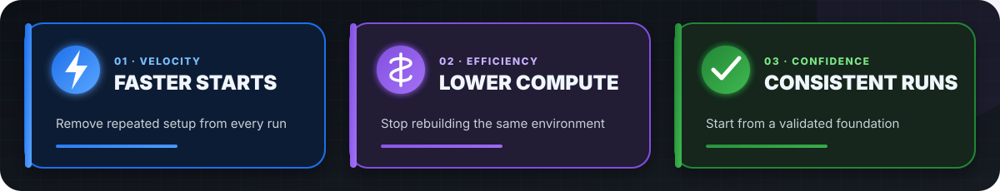

# ◈ Pre-warmed GitHub-hosted runners

### GitHub-managed foundation. Your software. Ready in seconds.

**Build once. Cut repeated setup, runner spend, and feedback time on every run.**

---

## ↯ Why custom images

  

> **ROI pattern:** Remove a repeated setup path once. Multiply its time and
> compute savings across every workflow run.

  

## ◆ Where they help

  

Capture work that is **large, stable, slow, deterministic, and safe**.

[See workload examples, architecture, caching guidance, and measured evidence →](docs/deep-dive.md)

## ⌘ Recommended implementation pattern

  

[Explore the implementation guide →](docs/deep-dive.md#implementation-guide)

---

**[Implementation, lifecycle, cost models & ROI, security, and measured evidence →](docs/deep-dive.md)**

[GitHub custom-image documentation](https://docs.github.com/en/enterprise-cloud@latest/actions/how-tos/manage-runners/larger-runners/use-custom-images)
· [Community examples](https://github.com/km-allthethings/build-custom-images)

